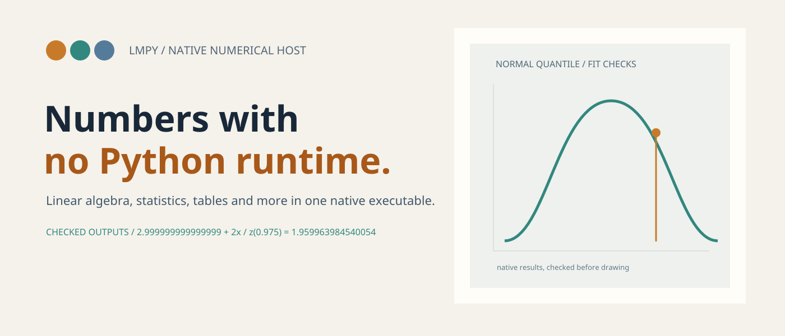
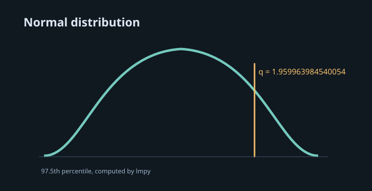
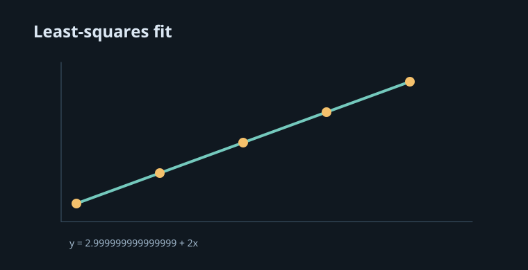
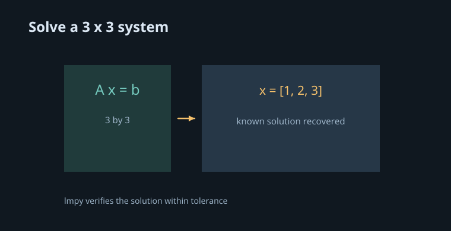
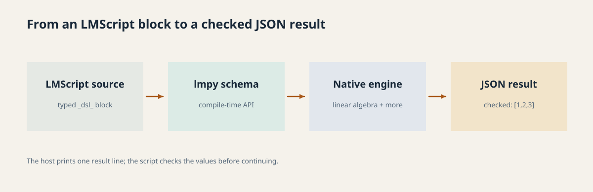

<p align="center">
  <picture>
    <source media="(prefers-color-scheme: dark)" srcset="docs/readme/hero-dark.png">
    <source media="(prefers-color-scheme: light)" srcset="docs/readme/hero-light.png">
    
  </picture>
</p>

**lmpy brings linear algebra, statistics, tables, optimization and machine learning to LMScript in one native executable.** Python, R and Docker are not needed at runtime.

[](https://github.com/lmctl-ai/lmpy/releases) [](https://github.com/lmctl-ai/lmpy/actions/workflows/ci.yml)

## Made with lmpy

| Probability | Least squares |
| --- | --- |
|  |  |
| The standard normal 97.5th percentile. [Source](examples/book/normal-quantile.lms) · [example book](https://lmctl.com/tools/lmpy/examples/normal-quantile.html) | Fit and check an intercept and slope. [Source](examples/book/least-squares-line.lms) · [example book](https://lmctl.com/tools/lmpy/examples/least-squares-line.html) |

### Linear algebra



Recover and check a known solution. [Source](examples/book/matrix-solve.lms) · [example book](https://lmctl.com/tools/lmpy/examples/matrix-solve.html)

## How it works

The diagram is rendered with [lmdraw](https://github.com/lmctl-ai/lmdraw) from [docs/readme/architecture-light.lms](docs/readme/architecture-light.lms). lmpy checks the example result used in the final node; its host emits one JSON result line for the calling LMScript program.

<picture>
  <source media="(prefers-color-scheme: dark)" srcset="docs/readme/architecture-dark.png">
  <source media="(prefers-color-scheme: light)" srcset="docs/readme/architecture-light.png">
  
</picture>

## Quick start

```sh
npm i -g @lmctl-ai/lmctl
lmctl init
lmctl autorun lmpy_solo
```

Use the published [trio script](https://lmctl.com/tools/lmpy/lmpy_trio.lms) for the Lead/Coder/Reviewer flow. For local programs, use `cli="lmpy" install="github:lmctl-ai/lmpy@latest"` in an LMScript `_dsl_` block.

## Learn and download

- [Get started](https://lmctl.com/tools/lmpy/get_started.html) · [tool guide](https://lmctl.com/tools/lmpy/guide.html) · [examples book](https://lmctl.com/tools/lmpy/)
- [API summary](native/API.md) · [release downloads](https://github.com/lmctl-ai/lmpy/releases)
- [Python parity recipes](examples/python/): 29 published numpy, scipy, pandas, statsmodels, scikit-learn and networkx examples next to their lmpy versions, every value checked against Python
- [LMScript language and DSL docs](https://lmctl.com/tools/lmscript/skill.html)

## Artwork and examples

Regenerate the README artwork and gallery with `docs/readme/render.sh`. The lmscript sources live in `docs/readme/`; gallery images are drawn from the checked and released lmpy example outputs.

## License and company

MIT License; Copyright (c) 2026 Lattice Systems LLC. See [LICENSE](LICENSE).

Made by **Lattice Systems LLC**.

<details>
<summary>Historical pycli implementation and detailed reference</summary>

# pycli (legacy)

An MIT C++17/lmcpp frontend for pinned NumPy 2.3.3 / SciPy 1.16.2 / pandas 2.3.3 / statsmodels 0.14.6 / scikit-learn 1.7.2 (S0–S7).
Each call starts a fresh Python child. The fixed dispatch and validated inputs
accept no caller code. The Docker container is the isolation boundary.
All file writes use `result.artifacts[name]` with the same descriptor fields:
`ref,path,format,key,dtype,shape,nbytes` (full contract below).

| Operation | Access | Inputs | Result |
|---|---|---|---|
| `py_info` | read | none | versions, OpenBLAS pools/threads/core, PCG64 RNG kind, architecture, worker SHA256, hash/isolation flags, `provenance` (version, pycli git sha, pinned lmcpp revision, SHA-256 of both wheel locks) |
| `la_solve` | read | a, b, assume_a=gen/sym/pos | x, rcond estimate, residual norm, domain status |
| `la_solve_to` | write | same plus exclusive out.safetensors | x descriptor; fails if no artifact is produced |
| `stats_dist` | read | dist (31 families, see S8b-2 below), fn=pdf/logpdf/cdf/logcdf/sf/logsf/ppf/isf/moments/rvs, x vector (<=1000), params; rvs: n and a REQUIRED integer seed | values and captured warnings; moments with `moments_undefined`; rvs echoes seed and generator (PCG64) |
| `stats_dist_to` | write | fn=pdf/logpdf/cdf/logcdf/sf/logsf/ppf/isf at up to 200,000 points, or rvs (same dist/params/seed, n up to 1,000,000); exclusive out.safetensors, key (default x) | n_values, n_missing, sample size, seed, generator, artifacts[key] descriptor |
| `array_import` | write | format=json/csv/csv_file/npy/safetensors, data, key (default x), header, na=nan/error, exclusive out.safetensors | new F64 artifact descriptor, source dtype, finite/NaN/Inf counts, min, max, norm, na_count (pure C++, no Python) |
| `array_inspect` | read | ref (inline, file.npy, file.safetensors#key, or bare file.safetensors), limit<=1000 | dtype, shape, size, counts, min, max, norm, preview; a bare safetensors path lists tensors from the validated header only |
| `la_lstsq` | read | a (m by n), b, rcond, driver=gelsd/gelsy/gelss | x (<=1000 numbers), rank, singular_values, residues, residual_norm, status OK/RANK_DEFICIENT/NO_CONVERGENCE |
| `la_lstsq_to` | write | same plus exclusive out.safetensors | x descriptor and the same fields; RANK_DEFICIENT still writes the minimum-norm x |
| `la_props` | read | a, what (det, slogdet, rank, cond, norm, trace, inverse), norm_ord, cond_p, rank_tol | requested scalars; inverse (<=1000 numbers) with inverse_residual; status OK/SINGULAR/NO_CONVERGENCE |
| `opt_minimize` | read | objective expression, x0 `{name: number\|[numbers]}`, method (Nelder-Mead, Powell, BFGS, L-BFGS-B, SLSQP, trust-constr), bounds, constraints `[{type: eq\|ineq, expr}]`, gradient expressions, data, tol, maxiter, max_evals, nonfinite | par, fun, status OK/NO_CONVERGENCE/EVAL_LIMIT/TIME_LIMIT/NON_FINITE, message, nit, nfev, evals, nonfinite_evals, constraint_violation |
| `opt_least_squares` | read | model + response or residual expressions, x0, data, bounds, method trf/dogbox/lm, loss, f_scale, sigma, absolute_sigma, tol, max_nfev | par, std_err (Jacobian), cov_status, cost, rss, status, nfev |
| `num_quad` | read | f(x), a, b (finite or "Inf"/"-Inf"), epsabs, epsrel, limit, points | value, abserr, neval, subdivisions, status OK/NO_CONVERGENCE/NON_FINITE/EVAL_LIMIT |
| `num_root` | read | f(x), bracket lower/upper, method brentq/bisect/ridder/toms748, xtol, rtol, maxiter | root, f_root, iterations, function_calls, status |
| `opt_root` | read | equations (n expressions), start {name: number} (n unknowns), method hybr/lm (or a 1-D bracket -> brentq), xtol, residual_tol, max_evals | x {name: value}, fun, residual_max, status OK/NO_CONVERGENCE/EVAL_LIMIT/TIME_LIMIT/NON_FINITE (success verified by the residual) |
| `la_decomp` | write | a, kind=svd/qr/eig/eigh/cholesky/lu, full, pivoting, lower, exclusive out.safetensors | one descriptor per factor, small eigen/singular values inline, reconstruction_error, status |

Arrays accept nested row-major JSON, `{shape:[r,c],data:[...]}`, or cwd-confined
`file.npy` / `file.safetensors#key` refs, rank 1 or 2. Little-endian C-order `.npy` v1/v2
with dtype `<f8 <f4 <i8 <i4 |b1 |u1` and safetensors `F64 F32 I64 I32 U8 BOOL` are
converted exactly to binary64 inside C++ (an integer beyond 2^53 is refused, never rounded;
Fortran order, object arrays, complex, rank 0/3+ and .npz are rejected). Headers, shapes,
offsets and lengths are validated before Python; safetensors reads only the selected bounded
payload, and the selected tensor's rank and 200000-number cap are checked from the header
before any allocation. The `.npy` header is parsed by a hand-written closed grammar (no regex).
Array artifacts written by pycli are F64 (`I64` for the qr pivot vector `p`); table artifacts use the S2 dtype whitelist below.

Limits: 1000 numbers per inline array, 200000 per referenced array/CSV file (inline CSV text
1000), 256 MiB per artifact, 32 MiB per array CSV (`array_import`; frame CSV is 16 MiB, see Tables), at most 2,000,000 output numbers per call.

Matrix order is **447 by ref / 31 inline** (square). la_solve returns <=1000 solution
numbers; larger solutions require la_solve_to (likewise la_lstsq / la_lstsq_to). stats_dist returns <=1000 values.
Solve requires finite data; sym/pos require exact symmetry. pos explicitly checks
positive definiteness. Read solves return SINGULAR or NOT_POSITIVE_DEFINITE;
write solves return COMMAND_FAILED with that tool_code and produce no artifact.
Outputs install with an anonymous inode and an atomic no-replace link. This
requires a Linux filesystem supporting O_TMPFILE and /proc/self/fd linking.
Cancellation during writing cannot leave a named partial file; a completed
atomic installation cannot be undone by a later cancellation.

## Quick start

Requirements on the host: Docker (daemon running, able to build images; the shim never pulls), git, Python 3 (gates and
measurement scripts), and `lmscript` from the npm package `@lmctl-ai/lmctl` (`npm install -g @lmctl-ai/lmctl@0.2.207`, the version
verified here; it brings `lmctl` as well). The build needs a checkout of `lmctl-ai/lmcpp` at `93a1847c081894ab1e9ed02ad5ea6350b5d5bd06`
(default path `/home/ubuntu/repos/lmctl-ai/lmcpp`, override with `LMCPP_DIR=/path/to/lmcpp`).

```sh
git clone https://github.com/lmctlhq/pycli.git && cd pycli
./scripts/build.sh runtime            # network only during the build: hash-locked wheels, pinned Debian snapshot; ~10 min cold
export PATH="$PWD/bin:$PATH"          # bin/pycli is the host shim; nothing is installed anywhere else
mkdir -p ~/work && cd ~/work          # calls must run from a directory below HOME (not HOME itself)
pycli py_info                         # first call: versions, BLAS pools, build provenance
pycli --schema > cli.schema.dev.json  # the published schema; identical to the checked-in file
cp -r /path/to/pycli/examples .       # recipes import "../cli.schema.dev.json" and examples/schemas/*.json
lmscript --check examples/solve.lms && lmscript examples/solve.lms
```

Verified from a fresh shell with nothing but `HOME` and `PATH` set (`env -i HOME=$HOME PATH=<pycli>/bin:<node>/bin:/usr/bin:/bin`):
`solve`, `lstsq-fit`, `sales-report`, `graph-route-plan` and `distributions-tour` exit 0; `pycli py_info` from `/tmp` is refused with
`INVALID_REQUEST` (exit 2) before Docker is touched. `scripts/run-recipes.sh` runs all 52 recipes (examples/README.md lists them, including the fifteen `tut-*` tutorial conversions and the seven `cross-*` Python/R agreement recipes) in real, `--check` and `--dry-run`
modes the same way (the optional `rcli`, `statsrust` and `lmda` legs print their setup hints when those tools are not on PATH).

Working-directory rule and shim hardening: the shim bind-mounts exactly the current directory (read / write) into the container and
rejects a cwd that is not below `$HOME`, is `$HOME` itself, or contains a comma, quote, equals sign or control character (they would
break the mount syntax). Every path in a call is relative to that directory and confined to it. The container runs `--network=none`,
`--read-only`, `--cap-drop=ALL`, `--security-opt=no-new-privileges`, `--pids-limit=128`, `--cpus=2`, `--memory=4g`, a 512 MiB
`noexec,nosuid,nodev` tmpfs for its private temporaries, as your uid:gid, with `--init` and `--pull=never`; only `PYCLI_TIMEOUT_S`,
`PYCLI_BLAS_CORETYPE`, `PYCLI_READONLY` and `PYCLI_DRYRUN` are forwarded. A Docker failure is `SERVICE_UNAVAILABLE` (exit 8), a
container killed by a signal is `TOOL_CRASH` (exit 1); Ctrl-C kills and removes the container (exit 130). Continuous integration
(`.github/workflows/ci.yml`) repeats the build, the full test image, the gates and every recipe on arm64 and on amd64; this host is
aarch64, so the amd64 statement below rests on that job alone.

## Conventions

Every operation is one validated call: `pycli <op> --input-json '{...}'` (or lmscript's `pycli.<op>({...})`), a JSON result on stdout, an
lmapi error envelope and a non-zero exit code otherwise (docs/reference.md lists the codes). The rules below hold for all 68 operations.

* **Read / write twins.** A read operation returns its answer inline, at most 1000 numbers (`OUTPUT_TOO_LARGE` beyond that, with a hint),
  and never creates a file. Its `_to` twin takes the same parameters plus `out` (a new path inside the working directory; `CONFLICT` if it
  exists) and writes the full result to an artifact. Write forms honour `--readonly` / `PYCLI_READONLY` (exit 6) and `--dryrun` /
  `PYCLI_DRYRUN` (a simulated envelope, no file). A write form whose domain status is not `OK` writes nothing and fails with
  `COMMAND_FAILED`, `error.data.tool_code` = the status, the bounded result fields under `error.data`.
* **One artifact descriptor.** `result.artifacts[name] = {ref, path, format, key, dtype, shape, nbytes}` and `outputs_in_artifact: true`.
  A tensor uses `ref = "path#key"`, `format = "safetensors"`, its dtype, shape and payload bytes; a whole-file descriptor (`table`, `model`,
  `export`) uses `ref = path`, format `npz` / `safetensors` / `csv` / `json`, null key / dtype / shape and the file size. Readers take the
  descriptor's `ref`. Artifacts are installed atomically (anonymous inode, no-replace link): a cancelled write leaves no partial file.
  Take the tensor key from `artifacts` (`artifacts.<name>.ref`), never assume `x`: arrays, samples and distribution evaluations use `x`,
  `sig_filter_to` and `special_fn_to` write `y`, `interp_eval_to` writes `values`, `ode_solve_to` writes `t` and `y`, decompositions their
  factor names; a guessed `#x` is `TENSOR_NOT_FOUND`.
* **File sources.** Operations that read a file name the source by kind: `frame` (an `.npz` table), `csv` (a CSV path), `columns` /
  `records` (inline), `ref` or a `path#key` string (a tensor); `array_import` alone takes `format` plus `data` because it converts
  several kinds into one artifact. Every path is relative to the working directory and confined to it.
* **Formats.** Tables are `.npz` artifacts (typed columns, masks, categories; produced by `frame_import` from CSV, read by `frame` parameters)
  and CSV; arrays are safetensors (`path#key`) or `.npy` (read only). Nothing else is parsed: no pickle, Parquet, GraphML, model files of
  any library. Every file header is validated in C++ before a Python process starts.
* **Values.** Finite numbers round-trip exactly as binary64; `NaN`, `Inf`, `-Inf` are JSON strings; a missing value is `NA` (distinct from
  NaN in tables and in `stats_dist`). Integers beyond 2^53 are refused, never rounded. Results use the shortest round-trip decimal.
* **Statuses are results.** A domain outcome (`SINGULAR`, `INFEASIBLE`, `NO_CONVERGENCE`, `TIME_LIMIT`, ...) is `result.status` with exit 0
  in read operations; inspect it, not only the envelope. Validation failures are `VALIDATION_ERROR` (exit 2) with `tool_code`.
* **Budgets.** Every library call has pre-spawn caps (docs/reference.md) and the cooperative `time_limit` (default 10 s, at most 30 s)
  which answers `TIME_LIMIT`; `PYCLI_TIMEOUT_S` (at most 50 s, imports included) is the hard kill (`TIMEOUT`, exit 7).
* **Determinism.** Seeds are required and echoed wherever randomness enters (PCG64; a shorter sample is a prefix of a longer one); one BLAS
  thread; bit-exact results hold within one image on one CPU family, tolerance tiers apply across architectures (docs/parity.md).
* **Warnings** are captured, deduplicated and returned (`warnings`, at most 20 kinds, `warnings_truncated`); a library NaN on valid input
  carries a `NumericalWarning` instead of being silently returned.

## Errors, statuses and caps

[docs/reference.md](docs/reference.md) is generated from the code by `scripts/generate-reference.py` and gated by `tests/docs_gate.py`:
the protocol error codes with their exit codes (2 validation, 3 parse, 4 not found, 5 conflict, 6 readonly, 7 timeout, 8 service
unavailable, 1 command failed / internal), the host-shim envelopes, every domain status (`result.status`), every `error.data.tool_code`,
and every compile-time cap with its meaning. A status or code that is not in that table does not exist in the binary.

## What pycli is not

* **Not a Python language surface.** There is no `eval`, `exec`, `pickle`, `query`, formula string or callable anywhere in the worker
  (gated by tests/s0.py); the only expressions are the closed shared grammar of expr-spec.json (optimisation objectives, ODE right-hand
  sides, least-squares models, `frame_mutate`), parsed in C++ before Python starts. Caller code never runs.
* **Not a sandbox for arbitrary files.** It reads CSV, `.npy`, safetensors and its own `.npz` tables, nothing else; the import guard and
  audit hook are defence in depth, the container (`--network=none`, read-only root, dropped capabilities, 2 CPUs / 4 GiB / 128 pids) and the
  fixed dispatch are the wall. Model artifacts are numeric parameter bundles, never serialised estimators.
* **Not bit-reproducible across machines.** Determinism tiers: bit-exact for the same image on the same CPU family (seeded, one BLAS
  thread, pinned coretype on aarch64); tolerance tiers across architectures and against other tools (docs/parity.md, docs/oracle-findings.md).
  Cross-architecture bit equality is never claimed.
* **amd64 is verified by CI only.** This repository is developed and measured on aarch64. The amd64 build from the hash-pinned
  `docker/requirements-amd64.lock` passed the full CI job (`.github/workflows/ci.yml`: both images, 38/38 CTest groups, notices,
  schema and provenance gates, lmts parse, 90/90 recipe invocations) on `ubuntu-24.04` in GitHub Actions run 38913844742 on 2026-10-16
  (commit d611f5d); the first run (38901596246) had failed two groups, both tolerance / precision issues analysed in
  [docs/amd64-notes.md](docs/amd64-notes.md). No amd64 timing is measured, and bit equality across the two architectures is never claimed.
* **Not a Parquet / Arrow tool, not a plotting tool, not a persistent service.** Parquet is excluded from v1 (docs/decisions.md); every call
  is a fresh process in a fresh container (0.65-1.6 s per call, docs/timings.md); large results go to artifacts, not to stdout.
* **Not an installer or a publisher.** Images are built locally (`scripts/build.sh`), never pulled or pushed; nothing in CI publishes
  (RELEASE.md).

## Cross-language agreement

Seven recipes, `examples/cross-*.lms`, run the same seeded analysis through pycli (Python) and through R via the rcli shim from one
lmscript (both schemas imported with distinct aliases), print a side-by-side table (quantity, python, r, abs diff, tolerance, verdict)
and exit 1 on any disagreement. Tolerances are principled, never bit-exact except for pure arithmetic: OLS at 64 eps cond(X) (cond^2
for standard errors); GLMs at the IRLS stopping tolerance (1e-6 on estimates, 1e-5 on standard errors because R takes the working
weights from the penultimate iterate); test statistics at 1e-10 and p-values at 1e-12 relative; ACF/PACF at 1e-12; ARIMA parameters at
1e-4 and log-likelihoods at 1e-6 (same likelihood, different optimiser stopping points), comparing the process mean because statsmodels
parameterises the intercept differently from R; k-means by the adjusted Rand index and the within-cluster sum of squares (the
algorithms and random streams differ, the partition does not); nonlinear least squares at 1e-6 relative with the convergence
tolerances set on both sides; Rosenbrock minimisers against the exact minimum (R's optim finite differences cap its precision at 1e-3);
quadrature and roots at 1e-10; densities at 1e-13 and continuous quantiles at 1e-10 relative. Where the tools legitimately differ
(R's undamped nls needs a data-derived start, R's "intercept" is the mean), the recipe header says so and compares the invariant
quantity. No disagreement beyond tolerance was found (docs/parity.md). **The R legs are local-only**: rcli is a private repository
that the pycli workflow cannot check out, so CI runs the recipes with the R leg skipped (hint printed, exit 0: the Python leg,
`--check` and `--dry-run` are still gated) and the cross-language verdicts come from the development host (both architectures of
pycli are covered by CI; the R comparison was run on aarch64 with rcli commit a857035, R 4.3.3).

```sh
export PATH="$PWD/bin:$HOME/repos/lmctlhq/rcli/bin:$PATH"   # pycli shim and rcli shim (rcli:runtime image built in that repo)
lmscript examples/cross-ols.lms
```

## Timings

Host load when this table was assembled (2026-10-16): `uptime` load average 9.26 / 10.29 / 8.15 on 4 cores, so the host was **not idle**
and no new measurement was taken; every number below is the recorded measurement in the cited `docs/measurement-*.json` (idle-host runs
where the file says so; the S8b-2 rows were re-measured on an idle host after the S8b-2 review fixes). Regenerate the tables with
`python3 scripts/timing-table.py`; the method is 10 sequential fresh calls through the host shim, p50 of the wall time, plus the worker's
own `import_ms`. One call costs the Docker start (about 0.4 s), the interpreter and the imports of the family (the second table), then
the computation: 0.65 s for a numpy-only call, 1.0-1.2 s for scipy families, 1.7-2.0 s for statsmodels and scikit-learn.

| Operation family (representative small call) | p50 wall ms through the shim | worker import p50 ms | Source |
|---|---:|---:|---|
| py_info (numpy only) | 652 | 102 | `docs/measurement-s8b2-shim.json` (`py_info`) |
| array_import / array_inspect (pure C++, no Python) | 349 | n/a | `docs/measurement-s1-shim.json` (`array_import`) |
| la_solve (3x3) | 1205 | n/a | `docs/measurement-s1-shim.json` (`la_solve`) |
| la_lstsq (200 x 5; la_props, la_decomp similar) | 1237 | n/a | `docs/measurement-s1-shim.json` (`la_lstsq_200x5`) |
| frames (frame_import ... frame_resample) | 1004 | 373 | `docs/measurement-s2-review-shim.json` (`frame_import`) |
| opt_minimize (Rosenbrock, BFGS) | 1022 | 437 | `docs/measurement-s3-shim.json` (`opt_minimize_rosenbrock_bfgs`) |
| opt_linprog (small LP) | 1176 | 441 | `docs/measurement-s4-review-shim.json` (`LP`) |
| ode_solve (decay, RK45) | 1109 | 443 | `docs/measurement-s4-review-shim.json` (`ODE_decay_RK45`) |
| sm_ols (40 x 6) | 1736 | 1009 | `docs/measurement-s5-shim.json` (`sm_ols_40x6`) |
| ml_fit (logistic, 40 x 1) | 1970 | 1188 | `docs/measurement-s6-review-shim.json` (`ml_fit_logistic_40x1`) |
| interp_eval (pchip, 40 nodes) | 1065 | 461 | `docs/measurement-s7-review-shim.json` (`interp_eval_pchip_40`) |
| frame_to_array (100 x 2) | 686 | 114 | `docs/measurement-s8a-review-shim.json` (`frame_to_array_100x2`) |
| la_matrix_fn (expm 8x8) | 995 | 353 | `docs/measurement-s8b1-shim.json` (`la_matrix_fn_expm_8x8`) |
| special_fn (erf, 100 values) | 921 | 326 | `docs/measurement-s8b2-shim.json` (`special_fn_erf_100`) |
| graph_paths (dijkstra, 6 nodes) | 1077 | 455 | `docs/measurement-s8b2-shim.json` (`graph_paths_dijkstra_6`) |
| graph_flow (max_flow, 6 nodes) | 1093 | 447 | `docs/measurement-s8b2-shim.json` (`graph_flow_max_flow_6`) |
| stats_dist (genextreme cdf) | 1428 | 732 | `docs/measurement-s8b2-shim.json` (`stats_dist_genextreme_cdf`) |
| stats_dist rvs (norm, numpy only) | 679 | 107 | `docs/measurement-s8b2-shim.json` (`stats_dist_norm_rvs`) |

| Import group (what the worker imports for the family) | worker import p50 ms | Source |
|---|---:|---|
| numpy only (py_info, stats_dist rvs of the S8a families, frame bridge) | 102 | `docs/measurement-s8b2-shim.json` (`py_info`) |
| scipy.special (special_fn) | 326 | `docs/measurement-s8b2-shim.json` (`special_fn_erf_100`) |
| scipy.stats (stats_dist evaluations) | 732 | `docs/measurement-s8b2-shim.json` (`stats_dist_genextreme_cdf`) |
| networkx + scipy.sparse.csgraph (graph_paths, graph_flow) | 455 | `docs/measurement-s8b2-shim.json` (`graph_paths_dijkstra_6`) |
| scipy.optimize (opt_minimize, opt_least_squares, num_quad, opt_root) | 437 | `docs/measurement-s3-shim.json` (`opt_minimize_rosenbrock_bfgs`) |
| scipy.optimize HiGHS / scipy.integrate (opt_linprog, ode_solve) | 441 | `docs/measurement-s4-review-shim.json` (`LP`) |
| scipy.interpolate / signal / spatial (S7) | 461 | `docs/measurement-s7-review-shim.json` (`interp_eval_pchip_40`) |
| pandas (frames) | 373 | `docs/measurement-s2-review-shim.json` (`frame_import`) |
| statsmodels (sm_*) | 1009 | `docs/measurement-s5-shim.json` (`sm_ols_40x6`) |
| scikit-learn (ml_*) | 1188 | `docs/measurement-s6-review-shim.json` (`ml_fit_logistic_40x1`) |
| scipy.linalg (la_matrix_fn, la_sparse) | 353 | `docs/measurement-s8b1-shim.json` (`la_matrix_fn_expm_8x8`) |

| Runtime image (content bytes, `docker image inspect .Size`) | Bytes | MB | Source |
|---|---:|---:|---|
| S0 (first runtime) | 115700011 | 115.7 | `docs/measurement-runtime.json` |
| S0 review fix (pruned, fresh base) | 97450776 | 97.5 | `docs/measurement-review-packaging.json` |
| S2 (pandas) | 110691742 | 110.7 | `docs/measurement-s2-packaging.json` |
| S3 (expressions) | 115206817 | 115.2 | `docs/measurement-s3-shim.json` |
| S4 (HiGHS, ODE) | 115249079 | 115.2 | `docs/measurement-s4-review-packaging.json` |
| S5 (statsmodels) | 124998107 | 125.0 | `docs/measurement-s5-shim.json` |
| S6 (scikit-learn) | 136467787 | 136.5 | `docs/measurement-s6-review-shim.json` |
| S7 (interp / signal / spatial) | 136513714 | 136.5 | `docs/measurement-s7-review-shim.json` |
| S8a (bridge, metrics) | 136587173 | 136.6 | `docs/measurement-s8a-review-shim.json` |
| S8b-1 (matrix functions, sparse) | 136632374 | 136.6 | `docs/measurement-s8b1-shim.json` |
| S8b-2 + review fixes (networkx; now) | 139247426 | 139.2 | `docs/measurement-s8b2-shim.json` |

| Hardened-container peak (2 CPUs, 4 GiB, read-only root, `--network=none`) | cgroup peak MB | Source |
|---|---:|---|
| S2 frame caps (200000 rows / 500000 cells / 16 MiB CSV) | 255 | `docs/measurement-s2-review-caps.json` |
| S4 LP / ODE caps | 105 | `docs/measurement-s4-review-caps.json` |

Per-cap worst cases (wall seconds, exit codes and cgroup peaks under the 2 CPU / 4 GiB container for every slice's caps) are the
`measurement-*-caps.json` / `.txt` files summarised per slice in [docs/timings.md](docs/timings.md); the acceptance paragraph there records
the CTest, recipe and build exit codes of the current tree.

### S1 arrays and dense linear algebra

Missing values: `null`, `"NA"` and an empty CSV field are *missing*; `"NaN"`, `"Inf"`, `"-Inf"`
(and CSV `NaN/Inf/-Inf`) are values. Both are stored as NaN in the artifact (`na_count`
reports the missing ones; `na:"error"` refuses them). CSV is strict: comma separated, optional
header, no quotes and no blank lines (a UTF-8 BOM is skipped); a single column gives rank 1,
otherwise rank 2. Numbers use a fixed decimal grammar (`1e999` and underflow-to-zero are errors,
denormals are exact). Inspect statistics: min/max ignore NaN but keep infinities
(`"NA"` if every value is NaN); `norm` is the Frobenius norm computed with scaling so it
neither overflows nor underflows, and is `NaN`/`Inf` when the data contain them.

Statuses (exit 0 in read ops; write ops fail with COMMAND_FAILED, `tool_code` = status, and
produce no artifact): `SINGULAR` (la_props withholds an inverse when numpy's default rank test
says rank < n, conservative: `diag(1,1e-20)` counts), `RANK_DEFICIENT` (la_lstsq: x is the
minimum-norm solution; la_lstsq_to still writes it), `NOT_POSITIVE_DEFINITE` (cholesky),
`NO_CONVERGENCE` (LAPACK SVD/eigen failure; svd retries `gesvd` after `gesdd`),
`NUMERICAL_FAILURE` (non-finite output, or a factorization whose `reconstruction_error`
exceeds 1e-8). Non-finite inputs and non-exactly-symmetric inputs to eigh/cholesky are
validation errors before Python starts. `la_lstsq` recomputes `residues` (per right-hand
side) and `residual_norm` from `A x - b` for every driver; `rcond` is scipy's `cond`.
`det` may be rounding noise for singular matrices (rank/cond are the tests of singularity;
`cond` is `Inf` when rank < min(m,n) under numpy's default tolerance); `trace` needs a square matrix;
the `eig`/`eigh` residual is scaled by `||A||_F ||V||_F`, so nilpotent/defective inputs are not
failures; `eig` returns `vr_cond` and a `NumericalWarning` when it exceeds ~6.7e7 (defective or
nearly defective: `vr` is then not a basis). Results never hold more than 1000 inline numbers:
`la_lstsq` refuses requests whose x + residues + singular values exceed that, `la_lstsq_to`
stores all x/residues/singular_values vectors in the artifact, including small ones. A missing input file or tensor key is
`NOT_FOUND` (exit 4); malformed references are validation errors (2).
An `{shape,data}` envelope takes flat row-major data or nested data of exactly that shape.
Safetensors files may hold any spec dtype (F16, BF16, ...): only selecting such a tensor fails.
a determinant outside binary64 is `Inf`/`0` plus a `NumericalWarning` pointing at `slogdet`.

`la_decomp` conventions (LAPACK via scipy.linalg; vectors keep LAPACK's signs, which are not
portable across BLAS/CPU, so compare invariants, not signs; magnitudes and the products below
are what the tests check against scipy called directly):

| kind | tensors | convention |
|---|---|---|
| svd | `u`,`s`,`vt` | `A = u[:,:k] * s @ vt[:k]`, k=min(m,n), `s` descending and >=0; `full:true` gives square `u`,`vt`; gesdd, gesvd fallback (reported as `driver`) |
| qr | `q`,`r` (+`p` int64) | economic by default, `full:true` for full Q; `pivoting:true`: `A[:,p] = q @ r`, `abs(diag r)` non-increasing |
| eigh | `w`,`v` | symmetric input; `w` ascending, `v` orthonormal columns, `A v = v diag(w)` |
| eig | `w_re`,`w_im`,`vr_re`,`vr_im` | complex output split into real/imaginary tensors; eigenvalues sorted by (real, imaginary) ascending, columns of the right eigenvectors permuted alike, unit 2-norm; `A vr = vr diag(w)` with `vr = vr_re + i vr_im` |
| cholesky | `l` (or `u` with `lower:false`) | `A = l @ l.T`; `u = l.T` |
| lu | `p`,`l`,`u` | `A = p @ l @ u`; `p` is an m by m permutation matrix, `l` unit lower m by k, `u` k by n |

Writes use the same exclusive anonymous-inode install as `la_solve_to`; an existing target is
CONFLICT (5), `PYCLI_READONLY` rejects writes (6), dry-run creates nothing. Import and inspect
never start Python, so they work (and are tested) with the interpreter missing.

### S3 expressions, optimisation, quadrature, roots

Callers never send code. An expression is an ASCII string (<=2048 bytes, <=512 tokens and nodes, depth 32, <=16
nested calls) in rcli's grammar: numbers, declared names, `+ - * / ^`, unary minus, relational and `& |` only inside
`ifelse(cond, a, b)`, the constants `pi` and `e`, and the allowlisted functions of `expr-spec.json` (`exp log log1p expm1
log2 log10 sqrt abs sin cos tan asin acos atan sinh cosh tanh floor ceiling trunc round sign gamma lgamma digamma pnorm dnorm
qnorm plogis atan2 pmin pmax beta lbeta choose lchoose`; reducers `sum mean prod min max` only where data columns
exist). The spec file and the shared accept/reject corpus (13/57) are byte-identical copies of rcli's (SHA-256 pinned in
the tests); the C++ parser is a copy with one extension: a variable declared as a vector (`x0: {"v": [1, 2]}`; bounds `{"v": [[0, 2], [0, 5]]}` per component or one pair for all) may be used
only as `v[0]`, `v[1]` with an integer literal below its length, and a scalar may not be indexed. Rejections happen in
C++ before any process starts (`EXPR_SYNTAX`, `EXPR_BAD_BYTE`, `EXPR_UNKNOWN_IDENT`, `EXPR_UNKNOWN_FUNCTION`, `EXPR_ARITY`,
`EXPR_TOO_LONG`, `EXPR_TOO_DEEP`, `EXPR_TOO_MANY_NODES`, `EXPR_NAME_COLLISION`, `EXPR_NOT_SCALAR`, `EXPR_INDEX`,
`EXPR_VECTOR_INDEX`, with `position` and `near`). Python receives only the JSON AST and compiles it iteratively
(no recursion, no `eval`/`exec`/`compile`/`getattr` on caller data) into a postfix program of numpy/scipy function *objects*
from a closed table, re-checking node kinds, arities, names and indices (`INTERNAL_ERROR`/`EXPR_SPEC_MISMATCH` otherwise).
Functions and operators follow **R's semantics** where rcli claims interchangeability: comparisons and `& |` are three-valued
(a NaN operand gives NA; `NA & FALSE` is FALSE, `NA | TRUE` is TRUE; numbers are true if nonzero), `ifelse` with an NA/NaN test
returns NaN (it does not take the else branch) and evaluates both branches, `^` follows R_pow (`(-8)^(1/3)` is NaN, a negative base
with an infinite exponent is NaN), `choose`/`lchoose` round `k` half-to-even with a one-time `NumericalWarning` and accept negative
`n`, `lchoose` works in the log domain (`lchoose(2000,1000)` = 1382.268 instead of an overflow), `beta`/`lbeta` are NaN for negative
arguments, `gamma(0)` and `digamma(0)` are NaN. `tests/expr-semantics-golden.json` holds R's answers for all 59 shared expressions on
a 20 x 19 grid of edge values (0, negative, non-integer, huge, +-Inf, NaN) and `tests/s3_semantics.py` requires pycli to reproduce
every cell; `scripts/expr-semantics-diff.py [--regen] [--rcli rcli]` regenerates the table from Rscript and runs spot cases through
the real rcli runtime. One known numerical difference: `choose`/`lchoose` with `|k| >= 1e9` agree on finite/non-finite class only.

Unknowns are scalars or vectors of at most 64 components in total; they are ordered by name (vector components by index),
which fixes the order of `gradient` expressions and of the flat vector. Data columns (`data`) are finite vectors from inline
arrays or `.npy` / `.safetensors#key` refs, equal length, <=200000 rows, <=32 columns; table (`.npz`) refs are not read
directly (export a column with `array_import`). Names are `[a-z][a-z0-9_]{0,31}` and may not collide with functions,
constants or each other (`BAD_NAME`, `EXPR_NAME_COLLISION`).

Statuses (exit 0): `OK`, `NO_CONVERGENCE` (the solver's own verdict, with its message, including "precision loss"),
`EVAL_LIMIT` (`max_evals`, default 500000, cap 2,000,000, counting every objective, gradient, constraint and residual
call), `TIME_LIMIT` (a wall-clock budget of the call timeout minus 10 s, checked before every evaluation including the gradient check, the final residual and the standard-error steps, so the worker stops before the hard kill) and
`NON_FINITE`. `EVAL_LIMIT`/`TIME_LIMIT`/`NON_FINITE` return the best point found so far by objective value; with constraints that point can be infeasible (read `constraint_violation`). A non-finite objective at `x0`
is `NONFINITE_OBJECTIVE` (exit 2; a non-finite analytic gradient at `x0` is `NONFINITE_GRADIENT`); later non-finite objectives count as +Inf (`nonfinite: "inf"`, reported as
`nonfinite_evals` plus a warning) or stop the run (`nonfinite: "error"`). Constraint violation above 1e-6 turns a solver
success into `NO_CONVERGENCE`. Gradient expressions are compared with finite differences at `x0` and a mismatch is a
`NumericalWarning`. Method rules are validated up front: bounds not for BFGS, constraints only SLSQP/trust-constr,
gradients not for Nelder-Mead/Powell; the default method is SLSQP with constraints, L-BFGS-B with bounds, else BFGS.

`opt_least_squares` is an iterative solver (scipy `trf`/`dogbox`/`lm`): on a model that is linear in its parameters it stops within the
cost's rounding floor, about 1e-9 of the exact least-squares solution on well-conditioned data; `sm_ols` (or `la_lstsq`) gives that exact
solution with standard errors, so prefer it for linear models. `opt_least_squares` fits `model` against the `response` column (residual = (model - response)/sigma, `sigma` a positive
number or data column) or minimises concatenated `residuals` expressions. Standard errors: with the central-difference
Jacobian J at the solution (scipy's own 2-point Jacobian is only first-order accurate with an absolute step and was off in the
5th digit for NIST Misra1a), `cov = (J'J)^-1`, multiplied by `2*cost/(m-n)` (`curve_fit` convention) unless `absolute_sigma`. Each
column uses a ladder of nine central-difference steps around `eps^(1/3) * max(|x_j|, 1e-4 * rho/||J_j||)` (rho the residual scale,
J_j the solver's column) and keeps the step whose neighbours agree best, so a parameter that is ~0 at the solution or a response of
magnitude 1e6 still gives standard errors accurate to ~1e-6 (closed-form OLS fixtures for y = 1000x, 1e6 x, 1e-3 x; Misra1a). Columns
are equilibrated and the Jacobian is declared singular below a **1e-8 relative singular value** (`SINGULAR_JACOBIAN`, standard errors
`"NA"`): legitimately worse-conditioned fits such as high-degree polynomials land here, and `jacobian_condition` (of the equilibrated
Jacobian) lets you judge; above 1e6 a `NumericalWarning` says the errors may be inaccurate, and `JACOBIAN_UNCERTAIN` means the
finite-difference and solver Jacobians disagree by more than 0.1 % on some column. `cov_status` is `OK`, `SINGULAR_JACOBIAN`,
`NO_DOF` or `UNAVAILABLE_BUDGET` (standard errors are then `"NA"`). The residual count times the number of unknowns is capped at
20,000,000 before spawn (vector residual expressions count `rows` each): `INPUT_TOO_LARGE`. With a robust `loss` scipy's loss-modified Jacobian is used and `std_err` is approximate. The solver runs
with `x_scale="jac"` and `tol` (default 1e-10) for ftol/xtol/gtol.

`num_quad` is QUADPACK (`scipy.integrate.quad`, `full_output`): a warning-level failure (oscillatory or divergent integrand,
`limit` exhausted) is `NO_CONVERGENCE` with the QUADPACK message and the unreliable `value`/`abserr`; a non-finite integrand
value (e.g. a pole on a Gauss-Kronrod node) is `NON_FINITE`. `num_root` needs finite `f(lower)`, `f(upper)` of opposite
sign (`NONFINITE_BRACKET`, `BAD_INTERVAL`, exit 2); an exactly-zero end is returned at once with 0 iterations. `xtol` is a bracket
width, not an `|f|` target. A singularity on the midpoint node of a symmetric interval (`1/sqrt(abs(x))` on [-1, 1]) is `NON_FINITE`;
the message suggests `points`.

S3 latency through the shim is about 1.0-1.1 s per call (p50), of which ~0.43 s is the worker's NumPy/SciPy import; runtime image
unchanged at 527 MB on disk. Details: [docs/s3.md](docs/s3.md), [docs/timings.md](docs/timings.md).

Distribution params accept loc (default 0), scale (positive, default 1), and
positive df for t. ppf rejects probabilities outside [0,1], including infinities;
NaN/missing pass through. Extremely small positive df may make SciPy return NaN;
pycli preserves that value with NumericalWarning rather than inventing a df
floor. Warnings are deduplicated/counted, capped at 20 distinct entries, with
warnings_truncated. Nonfinite JSON strings: NaN, Inf, -Inf. Numeric missing
null/NA becomes NA in distribution results. Finite values make an exact binary64
round trip; CLI output uses shortest round-trip decimal representations (the
private worker codec uses 17 significant digits). Cross-architecture bit equality
is not claimed; BLAS/CPU/version differences remain relevant.

```sh
./scripts/build.sh test
docker run --rm --pull=never --network=none pycli:test   # CTest: S0 + S1, including ASan/UBSan runs
./scripts/build.sh runtime
python3 tests/review_shim.py bin/pycli
python3 tests/container_review.py bin/pycli
./scripts/clean-builder.sh
export PATH="$PWD/bin:$PATH"
pycli --schema
pycli --input-json '{"op":"stats_dist","params":{"dist":"norm","fn":"ppf","x":[0.975]}}'
lmscript --check examples/solve.lms
lmscript --dry-run examples/solve.lms
lmscript examples/solve.lms
lmscript examples/lstsq-fit.lms     # polynomial fit with la_lstsq, residual and normal-equation checks
```

The build uses the pinned local lmcpp revision through its installed CMake
package. Separate cp312 wheel hashes are checked in for aarch64/amd64. Builder
and test apt use the signed immutable Debian **20261012T000000Z** snapshot and
exact top-level versions; runtime retains the full package/compiler inventory,
.deb hashes and package copyrights at `/usr/share/doc/pycli/build`. Scientific
licenses are supplemented by hash-verified matching source notices, including
nlohmann JSON and SuperLU. Runtime copies a pruned scientific installation into
a fresh pinned base, so deleted wheel test bytes are absent from its layers.
Pip already supplied by the base is hidden; its shared base-layer bytes remain.
Network acquisition happens only during builds. Invocation uses --pull=never.

The shim rejects cwd outside HOME or containing comma, quote, equals or control
characters before invoking Docker. It mounts only cwd read/write, disables
network, keeps the rootfs read-only, drops all capabilities, enables
no-new-privileges and Docker's default seccomp, and sets 2 CPUs / 4 GiB / 128
process limits. --init forwards signals; direct namespace PID 1 runs also exit
correctly on TERM/INT. The shim forwards signals to its named container, waits
for the Docker client, and exits 143/130. Worker/request/response copies live in
container-only **512 MiB noexec/nosuid/nodev tmpfs**, never the workspace. A
container SIGKILL/OOM discards them. A shim SIGKILL cannot be trapped; the
remaining container still has the 50-second worker timeout and no workspace
request copies. Host diagnostic captures can remain in the host temp directory
after untrappable SIGKILL; this is not a worker/request copy in the workspace.

The child uses **-P -s -B** and a fully replaced environment. No PYTHONPATH,
PYTHONHOME or user site is inherited, cwd/script directory stay off sys.path,
and PYTHONHASHSEED=0 works. py_info reports/verifies these guarantees. The
interpreter override exists only in the CTest development binary; production
ignores PYCLI_PYTHON. PYCLI_TIMEOUT_S can only lower 50 seconds. OpenBLAS uses
one thread with verified ARMV8 on aarch64; amd64 Haswell remains unverified.

The import guard/audit hook is **defence in depth, NOT a sandbox**. Trusted
scientific imports run before it; removing sys.modules entries does not remove
cached references. ctypes/native calls and os.exec remain reachable to trusted
code. Caller code never runs; the container and fixed dispatch are the wall.
Import rejections use ImportError, allowing library fallback paths. S1 does
not widen this: every caller-supplied file (npy, CSV, safetensors) is parsed and
validated by C++, and Python only sees the C++-written float64 `.npy` copies in the
private tmpfs. Extending audit gates for arbitrary file/process/native events stays
deferred; Python audit hooks cannot safely sandbox native code.

PYCLI_READONLY/PYCLI_DRYRUN and CLI policy flags reach lmcpp. Readonly rejects
writes (exit 6); dryrun simulates without files. lmcpp short-circuits handlers
on dryrun, so custom path/conflict checks are not performed in simulation.
Real existing outputs return CONFLICT (5). SIGSEGV maps to INTERNAL_ERROR /
TOOL_CRASH (1); missing interpreter remains SERVICE_UNAVAILABLE (8), matching
rcli. Unexpected numerical ValueError/OverflowError map to PY_ERROR (1); only
explicit worker prechecks map to validation errors (2). Huge invalid JSON such
as 1e999 gives PARSE_ERROR (3). See docs/parity.md for these choices.

Measurements and image sizes after these fixes are in [docs/timings.md](docs/timings.md).
The checked-in S0 raw measurements remain historical. amd64 locks are resolved;
execution/CI and Haswell verification remain pending, with no amd64 pass claimed.
The copied expression parser and rcli corpus have no exposed S0 expression ops.

| Review-fix runtime latency | p50 | p95 |
|---|---:|---:|
| py_info through shim | 0.861 s | 0.951 s |
| la_solve through shim | 1.348 s | 1.523 s |
| stats_dist through shim | 1.927 s | 2.033 s |

S1 (separate run, same method): `array_import` / `array_inspect` 0.35 s (no Python),
`la_lstsq` / `la_props` / `la_decomp` on 100-200 row inputs 1.2-1.3 s p50; see
[docs/timings.md](docs/timings.md). Runtime image unchanged: 446 MB, 97.43 MB content.

Current image sizes: runtime 446 MB / test 667 MB on disk; runtime content
metric 97.45 MB. Startup calibration: boot 17 ms, NumPy 200 ms, scipy.stats
1229 ms, Docker overhead 391 ms (p50, imports include boot). These timings are
slower than historical S0 samples; see the timing document for limitations.

S2 adds six narrow pandas operations:

| Op | Access | Behavior |
|---|---|---|
| `frame_import` | write | Exactly one of inline `columns`, `records`, UTF-8 `csv` path, or table `frame`; explicit `dtypes`, reported inference; exclusive `.npz` `out` |
| `frame_inspect` | read | Shape, dtype policy, null counts, head/tail and optional numeric describe |
| `frame_export` | write | CSV or columnar JSON; optional exclusive file `out`, otherwise <=1000 cells inline |
| `frame_select` | write | Structured literal predicates, stable `sort_by`, column selection, limit; required artifact `out` |
| `frame_groupby` | write | `keys` and column -> aggregation-list `aggs`; sorted keys, observed categories, optional `dropna` |
| `frame_resample` | write | Datetime `time` column, validated `rule`, aggregation lists, left/right `closed` and `label`; DST-aware bins |

Tables allow 200,000 rows, 500,000 cells, 256 columns and 256MiB artifacts.
CSV inputs are limited before spawn to 16MiB and UTF-8 string cells to 65,536 bytes.
Inputs and combined previews allow <=1000 inline cells. Summaries have a 32KiB
byte budget including metadata; the final response is limited to 64KiB. Preview
strings truncate to 64 characters with `preview_truncated:true`; categories retain
at most 20 levels with `n_categories`/`categories_truncated`, or metadata is omitted
with `column_meta_in_artifact:true`. Inline exports are lossless or fail with
OUTPUT_TOO_LARGE: use `out` for larger results. Full values remain in artifacts.
A table artifact is a single **stored-only NPZ** (compressed archives are refused),
with `__pycli_table__` UTF-8 JSON as a uint8 array, `cN` column arrays and `mN`
boolean missing masks. NumPy reads always disable object deserialization. C++ checks
ZIP bounds, sizes, overlaps, member counts and numeric/byte-array NPY headers before
spawn; Python rechecks metadata, column types, masks and category codes. NPZ is
supported only for tables; array ops retain the S1 formats. String columns use
UTF-8 bytes arrays, never object arrays. Names are unique nonempty UTF-8, <=256 bytes.
NUL characters in names and strings are refused.

The dtype whitelist is `int64`, `float64`, `bool`, `string`, `datetime64[ns]`,
`category`. Nullable ints/bools use masks; int64 is preserved exactly, including
values outside ±2^53 (lmscript numbers cannot represent those exactly). JSON null
means missing for every table dtype; numeric `NA` also means missing, while
`NaN`, `Inf`, `-Inf` are numeric values. String `NA` remains a literal string.
CSV empty fields and explicit `na_values` are missing; quoted empty fields also
count as missing. CSV defaults use strict integer/float/bool/string inference,
reported in `inferred`; leading-zero or plus-prefixed CSV numeric tokens infer
string to preserve identifiers. Numeric `NA` participates in nullable integer
inference; numeric overrides reject underscores and non-decimal syntax. Dates require `parse_dates` or a dtype override. Explicit
float overflow fails instead of becoming infinity. CSV exports use 17 significant
digits, explicit `NaN`/`Inf`/`-Inf` tokens and empty missing/NaT fields.
With matching dtype policies, numeric nonfinite values and missing masks round-trip. A float64 column whose values are all whole
numbers is exported as integers (`4`, not `4.0`) and re-imports as int64 unless `dtypes` overrides it: the dtype, not the values, is
lost through CSV; `.npz` tables keep it.
CSV cannot preserve category policy or distinguish empty strings from null; NPZ is the lossless handoff. JSON export is columnar, without hidden index.

Dtype objects accept `dtype` plus `tz` for datetime, or `categories`/`ordered` for
category. Closed timezones: UTC, America/New_York, America/Chicago,
America/Los_Angeles, Europe/London, Europe/Berlin, Asia/Tokyo, Asia/Kolkata,
Australia/Sydney. The pinned pytz/tzdata 2025.2 databases supply these names.
Aware ISO input requires explicit timezone; mixed aware/naive input is refused.
Naive local DST ambiguity/nonexistent times fail; offset-bearing input disambiguates.
Resample rejects NaT in its time column. Rules are 1..10000 plus
`min`, `h`, `D`, `W`, `MS`, `ME`, `QS`, or `YS`; default closure and labels are left,
except `ME` and `W`, which use pandas right/right defaults. Explicit options override these. Bins and group keys are materialized as ordinary columns.
Aggregates use a closed function table: sum, mean, min, max, count, std, var,
median, nunique, first, last. std/var use ddof=1; first/last skip missing values.
Integer sums use exact Python integers and fail `INT64_OVERFLOW` (exit 1) if
the result cannot fit int64; no wrapped artifact is written. String/category sums
are rejected. Reductions return missing for undefined results (including singleton
std); float NaN and masked null group keys merge into one missing group.
Datetime cells and predicates accept dashed ISO dates/timestamps only; natural
language and pandas special words are rejected. Empty CSV lines are ignored.
Aggregate names are flattened as `column__function`; collisions fail.

`where` uses `{and:[...]}`, `{or:[...]}`, `{not:...}`, or
`{col:"name",op:"eq",value:"literal"}`. Leaf operators: eq/ne/lt/le/gt/ge,
isin (list), isnull (no value), between (two inclusive bounds), startswith,
contains (literal, no regex). Comparisons exclude masked null cells; isnull selects only the missing mask, not explicit float NaN. Numeric predicates require numbers (float columns also accept NaN/Inf/-Inf tokens), int64 predicates require integral int64 values (50.0 accepted; 50.5 refused), bool predicates require booleans, and string/category predicates require strings. Datetime predicates require ISO literals with matching timezone awareness.
Predicate depth <=32 and nodes <=256. Column names and values are data.
Pandas is imported only by frame ops; other Python ops report `meta.pandas:"unloaded"`.
The audit guard remains defence in depth; the container is the process boundary.
All frame outputs use anonymous atomic no-replace installation and honor readonly/dryrun.

S2 review measurements (aarch64, ten sequential calls; p95=max): runtime
**527 MB** / **115,126,863 content bytes**, test **975 MB**. Restoring checked-hash
stdlib caches adds 4,434,181 content bytes versus an otherwise identical control.
Fresh pandas import compiles no stdlib sources. These are shared-host loaded
samples; an idle-host rerun is deferred because unrelated work remained active.

| Operation | p50 ms | p95 ms |
|---|---:|---:|
| `frame_import` | 1004 | 1047 |
| `frame_inspect` | 983 | 1007 |
| `frame_export` | 982 | 1022 |
| `frame_select` | 998 | 1099 |
| `frame_groupby` | 976 | 1060 |
| `frame_resample` | 1048 | 1175 |
| `la_solve` | 929 | 992 |
| `docker_overhead` | 406 | 434 |

CSV cap probes pass at 200000 rows / 500000 cells / near 16MiB: 1.20–2.53 seconds,
243MiB total cgroup peak under the 4GiB limit, including the probe harness.
See docs/timings.md and the separate measurement-s2-review-* raw files for
workloads, full host traces and the idle-host qualification. CTest passes 17/17
(312.74 s), including 19 review regressions, 17 original S2 groups and ASan/UBSan
parser fuzz. All three recipes pass real execution, --check and --dry-run.

Explicit int64 JSON columns accept integer tokens or decimal strings, not
floating tokens: lmcpp can promote an out-of-range JSON integer to a rounded
float. This prevents a value below INT64_MIN from silently becoming INT64_MIN.
Conversion of already typed float artifacts remains explicit and range-checked.

### S4: LP/MILP and ODE

| Operation | Access | Contract |
|---|---|---|
| `opt_linprog` | read | HiGHS dense LP/MILP; bounded inline x, slack and LP duals; never writes |
| `opt_linprog_to` | write | Same solve, all nonempty vectors in exclusive `out` safetensors |
| `ode_solve` | read | Closed-expression solve_ivp RHS/events; bounded inline trajectory; never writes |
| `ode_solve_to` | write | Same integration, time/state/event arrays in exclusive `out` safetensors |

These follow S1's read / `_to` pattern. Read forms work under `--readonly`; results
above the conservative inline budget (850 vector numbers or 24KiB vector JSON,
with room for metadata under the overall 1000-number /64KiB cap) fail with
`OUTPUT_TOO_LARGE` and recommend `_to`. They never create an automatic artifact.
Write forms require `out`, honor readonly/dryrun, and fail without an artifact.
`outputs_in_artifact` is explicit: false for inline, true for descriptors under
`artifacts` (the common contract below). Read tensor refs with `array_inspect` (limit<=1000).
An LP write without a primal fails; a partial ODE can still be saved with its
non-OK domain status. Inspect `result.status`, not just the protocol envelope.

LP: `c`, paired `a_ub/b_ub`, `a_eq/b_eq`, per-variable `bounds`, `integrality`
(continuous/integer/binary), `maximize`; 512 variables, 4096 combined rows and
200000 combined dense matrix entries. S1 inline/NPY/safetensors-ref inputs.
All finite input magnitudes, including bounds, are <=1e15; null or signed
`-Inf` / `Inf` tokens open bounds. Defaults [0,null]; equal bounds fix variables;
binary intersects [0,1]. Larger finite values fail validation before spawn with
`VALUE_EXCEEDS_SOLVER_LIMIT`, rather than becoming HiGHS infinity or model errors.

Rows are divided by their largest nonzero coefficient; the objective likewise.
Nonzero coefficient ratios per row/objective must be >=1e-9; scaled RHS magnitude
must be <=1e15. Unsafe ranges fail before spawn (`UNSAFE_COEFFICIENT_RANGE`).
The native small-coefficient cutoff is fixed at 1e-12. Marginals and objective/MIP
bounds are restored to original units. Original-data checks use per-row relative
residuals with no unit-sized absolute floor, bounds, integrality, LP dual signs,
stationarity, complementarity and primal/dual objective agreement (tolerance1e-7).
A failed check returns NUMERICAL_FAILURE, never OK. `primal_feasible`,
`primal_relative_violation`, `dual_feasible`, `dual_relative_violation`,
`relative_duality_gap` and `optimality_verified` expose the checks. MILP optimality
uses native gap/bound metadata, not an independently checked integer certificate.
Integer components within 1e-6 are rounded, signed zero normalized, and feasibility
rechecked on the returned x; `integrality_error` retains the pre-rounding error.

LP statuses derive from the preserved `highs_model_status`, not SciPy's ambiguous
status alone: OK, INFEASIBLE, UNBOUNDED, INFEASIBLE_OR_UNBOUNDED, MODEL_ERROR,
TIME_LIMIT, NODE_LIMIT, ITERATION_LIMIT, NUMERICAL_FAILURE. Unknown native statuses
fail conservatively. Original SciPy message/status remain. LP duals follow the
original objective, including maximize. MILP exposes available `mip_gap`,
`mip_node_count`, `mip_dual_bound`; nonzero requested-gap incumbents are labeled
incumbent. Limits: time >0..30s (default10), node 0..100000 (default10000),
iterations1..100000; mip_rel_gap0..0.1 (default0); one native thread.

ODE: one RHS per component in `y[i]`, `t`, optional named params/states; named y0
and RHS objects are sorted by name. At most32 states /16 parameters; S3 reserved
name rules apply (use b instead of beta). Methods RK45, RK23, DOP853, Radau, BDF,
LSODA; **stiff problems: use BDF/Radau/LSODA**. Default RK45 on stiff Robertson
can spend its full10s budget and return TIME_LIMIT/STEP_LIMIT/EVAL_LIMIT with an
accepted partial state. Tolerances are local solver controls, not global bounds.
rtol1e-13..0.1; scalar/per-state atol1e-15..0.1; optional positive max_step<=1e12.
Distinct finite t_span endpoints have abs<=1e12; forward/reverse supported.

Default101 uniform samples, max_output_points2..10000; timestamp duplicates due
to floating resolution are removed, preserving endpoints. `effective_output_points`
reports the grid size. Explicit ordered t_eval accepts inline/refs, with missing
endpoints added/reported. Potential trajectory/event/final output <=200000 numbers
is checked before spawn. Every RHS component, Jacobian RHS and event evaluation
shares max_evals (default/cap200000). Accepted max_steps default10000/cap20000;
wall default10s/cap30, bounded by the process budget with a two-second kill margin.

Up to4 events {expr,direction:-1/0/1,terminal:false}; roots exactly at the initial
time are excluded, including terminal events. Actual NaN/Inf expressions still
stop NON_FINITE. Per-event32-root cap gives EVENT_LIMIT; event_index is integer
(I64 in artifacts), grouped by event. A terminal event returns its localized root
state and time, including with coarse t_eval. Every non-OK result has
`termination:failed`, `partial_trajectory:true`; statuses include EVAL_LIMIT,
TIME_LIMIT, STEP_LIMIT, EVENT_LIMIT, NON_FINITE, STEP_SIZE_TOO_SMALL, NO_CONVERGENCE.
Callback interruption returns initial + last accepted state, never rejected trial
states; earlier samples/events are unavailable, so zero event counts are incomplete.

Examples: lp-plan.lms (CSV to hand-checked cost4 plan), ode-sir.lms (population
conservation and infected-peak event); both remain inline and use read operations.
HiGHS MIT is covered by the shipped SciPy notices. No new wheel.
See [docs/s4.md](docs/s4.md), [review fixes](docs/review-s4-fixes.md) and
[measurements](docs/timings.md). amd64 execution remains unverified.

Review acceptance: both image builds exit0; CTest **24/24, exit0** (592.68s),
including12 review and16 original S4 groups. Seven recipes pass real/check/dry-run
(21 exits0). Hardened cap probes pass with100.34MiB cgroup peak, including the
harness. Runtime527MB /115249079 content bytes; test1.06GB. Current image IDs,
shared-host timing samples and per-finding dispositions are in the linked docs.

### S5: statsmodels (OLS/WLS, GLM, SARIMAX, ACF/PACF)

| Operation | Access | Contract |
|---|---|---|
| `sm_ols` | read | OLS/WLS on a JSON term list; nonrobust, HC0-HC3 or one-way cluster covariance; coefficient table, R², F, llf, AIC/BIC, Durbin-Watson, condition number; optional inline `include` of `fitted`/`residuals` |
| `sm_ols_to` | write | Same fit; `coef` (p x 6), `fitted`, `residuals` (and `row_index` when rows were dropped) in an exclusive safetensors `out` |
| `sm_glm` | read | GLM by IRLS: gaussian, poisson, binomial, gamma with the documented links, offset/exposure/variance weights, deviance, null deviance, Pearson chi2, scale, llf, AIC/BIC |
| `sm_glm_to` | write | Same fit, artifact as `sm_ols_to` (response-scale fitted values and residuals) |
| `sm_arima` | read | SARIMAX exact Gaussian ML: order, seasonal order, trend, exog, optimizer, start parameters, parameter table, sigma2, llf, AIC/BIC/HQIC, forecast with intervals (h <= 100) |
| `sm_arima_to` | write | Same fit; `residuals` and `forecast` (3 x h: mean, lower, upper, h <= 1000) in an artifact |
| `sm_tsa_acf` | read | Sample ACF or PACF with confidence intervals, nlags <= 100 |

**No formulas.** Models are specified by a JSON term list; patsy, formulaic and `statsmodels.formula` are never imported (statsmodels'
package `__init__` imports `patsy.util` unconditionally, so the worker satisfies that single import with an empty stub that is removed
again, and the real packages are on the worker's blocked-import list; every response reports `meta.forbidden_modules_loaded`, tested to be
empty). The wheels for statsmodels 0.14.6, patsy 1.0.3 and packaging 26.3 are hash-locked for both architectures. Image and import costs are
in [docs/s5.md](docs/s5.md) and [docs/timings.md](docs/timings.md).

Data comes from exactly one of `columns` (inline table, <=1000 cells), `csv` (UTF-8 file with header, S2 limits: <=16 MiB, <=200000 rows)
or `frame` (a `.npz` table from `frame_import`, which carries typed and ordered-category columns). The response and other columns are named
in `y` / `series`, `weights`, `cluster`, `offset`, `exposure`, `exog`; names are 1-256 bytes of letters (any language), digits, space and
`_ . - % $ @ / #`, validated before spawn.

Terms (`terms`, 1-64, no strings): `{"const": true|false}`, `{"var": col}`, `{"cat": col, "ref": level}`, `{"interact": [col, col(, col)]}`,
`{"poly": [col, degree 2..6]}`. An intercept is included unless `{"const": false}`; its column position follows the list (default first).
Column names: `const`; `x`; `g[T.level]` (treatment coding, the reference level is mandatory and excluded; levels are the observed ones in
declared category order, sorted string order, numeric order, or False/True); `a:b` for interactions (factors in the order given; a categorical
factor must also have its own `cat` term and contributes its dummy columns); `x`, `x^2`, ... `x^d` for raw powers. Differences from other
tools: patsy writes `C(g, Treatment('b'))[T.a]`, R writes `ga`, and R's `poly()` is orthogonal unless `raw=TRUE`. The design is checked
against statsmodels' formula API in the test image (same coefficients and standard errors). At most 256 design columns and 10,000,000 design
cells; wider tables need `_to` (inline coefficient tables are limited to about 100 coefficients).

Missing values: null/NaN in any used column are *missing*. `na_action: "error"` (default) fails with `MISSING_VALUES` and a row count;
`"drop"` removes the rows and reports `n_dropped` (the kept rows keep their order; `_to` adds a `row_index` tensor). Infinities are always
`NONFINITE_DATA`. For `sm_arima`, missing series values are part of the state-space model and reported as `n_missing`.

Statuses (exit 0 unless the input is invalid): `OK`; `RANK_DEFICIENT` (the design has fewer independent columns than terms: estimates are
the minimum-norm solution, standard errors/tests/intervals are the string `NA`); `NO_CONVERGENCE` (GLM: IRLS hit `maxiter`; ARIMA: the
optimizer reported failure; results are returned but not trustworthy); `PERFECT_SEPARATION` (binomial); `TIME_LIMIT` (the call timeout minus
10 s and the import time elapsed; a cooperative SIGALRM budget around the library loops, no partial result); `NUMERICAL_FAILURE`. When the
model has no residual degrees of freedom `no_dof` is true and uncertainty columns are `NA`. Write twins fail without an artifact unless the
status is `OK` or `RANK_DEFICIENT`. Domain errors are exit 2: `BAD_TERMS`, `BAD_NAME`, `UNKNOWN_COLUMN`, `NOT_NUMERIC`, `BAD_REFERENCE`,
`BAD_RESPONSE` (poisson needs non-negative integers, gamma positive, binomial within [0,1]), `BAD_WEIGHTS`, `DUPLICATE_COLUMN`,
`TOO_MANY_COLUMNS`, `MISSING_VALUES`, `NONFINITE_DATA`, `BAD_START_PARAMS`, `CONSTANT_SERIES`.

OLS: `cov_type` nonrobust|HC0..HC3|cluster (`use_t` defaults to true for nonrobust, false otherwise, as in statsmodels); the robust overall F is
computed on the array API (statsmodels' own `fvalue` path needs patsy) and tested against it; it is `NaN` when the design is rank deficient
or the robust covariance has fewer effective dimensions than coefficients (e.g. fewer clusters than coefficients). Overflowing sums of squares
give `NUMERICAL_FAILURE`. `aic`/`bic` count `k_params` = number of design
columns, statsmodels' (and lmstats') convention; R counts one more (the error variance), so R's AIC = aic + 2 and BIC = bic + ln(n)
(recorded in docs/oracle-findings.md). GLM links: gaussian identity|log|inverse_power, poisson log|identity|sqrt, binomial
logit|probit|cloglog, gamma inverse_power|log|identity (first is the default); `exposure` needs the log link; `weights` are variance
weights; `maxiter` <= 100 (`n_iter` is reported), `tol` is the IRLS deviance tolerance; gaussian/gamma use the Pearson-based scale. GLM
inference follows R's `summary.glm`: t with `df_resid` for gaussian and gamma (estimated scale; `sm_glm` gaussian equals `sm_ols`), z for poisson
and binomial, and z for every robust `cov_type`; `use_t` overrides. `n_iter` counts IRLS updates (R's `iter` for the same fit is one higher: it
counts the final evaluation). A fitted mean outside the family support (e.g. a negative Poisson mean with the identity link) is `NUMERICAL_FAILURE`
with `NA` uncertainty; `rank_deficient: true` is reported next to the more severe status instead of replacing it. Gamma `llf` is evaluated at
statsmodels' Pearson scale, whereas R's `logLik` uses deviance/n, and R's AIC counts the dispersion as a parameter (see docs/oracle-findings.md).
There is no prediction operation: `fitted`/`residuals` cover the training rows only; rebuild the design from `coefficients.names` and `coding`.

ARIMA: `order` p,q <= 5, d <= 2; `seasonal_order` P,Q <= 2, D <= 1, s in 2..24; state dimension <= 64 and <= 24 parameters; series <= 20000
observations and observations x states^2 <= 2.5e7 (the fitted results keep several n x states x states covariance arrays; the worker rejects
larger models with `INPUT_TOO_LARGE` before fitting). The default `lbfgs` fit is followed by a short Nelder-Mead polish for models with at most
8 parameters (`polished` reports it): statsmodels' finite-difference score stalls L-BFGS on the flat likelihood ridge. Parameter names are statsmodels' (`intercept`/`drift`, exog names, `ar.L1`, `ma.L1`, `ar.S.L12`, ..., `sigma2` last). The `c` trend
is the regression intercept, so an AR model's mean is `c / (1 - sum phi)`, whereas R's `arima` reports the mean itself. `cov_type`: `opg`
(statsmodels default), `oim`, or `approx` (numerical Hessian: what R reports). `nobs_effective` excludes the diffuse observations of
differencing (`aic`/`bic` use it). Forecast intervals are normal: `mean +- z(1-alpha/2) * se`. `start_params` must have the model's exact
parameter count.

ACF/PACF: `acf` is the biased (divide by n) estimate like R unless `adjusted`; confidence intervals are Bartlett's for the ACF and
`+-z/sqrt(n)` for the PACF; PACF methods `ywm` (R's), `ywadjusted`, `ols`, `ldb`; `nlags` < n (PACF: < n/2). Constant series are `CONSTANT_SERIES`. The series is rescaled by its largest magnitude first, so
the correlations are exact for any finite scale (1e-300 .. 1e300); undefined results are `NUMERICAL_FAILURE`.

## S6 machine learning

| Op | Access | Result |
|---|---|---|
| `ml_fit` | write | 13 closed numeric model families to exclusive safetensors; four forest/boosting families fit+predict to NPZ without a model |
| `ml_predict` | write | Version/attribute-checked model to NPZ: predict / predict_proba / decision_function / transform; bounded preview |
| `ml_cv` | read | Kfold/stratified/group/timeseries supervised CV, fold scores and population mean/std |

Pinned sklearn 1.7.2, joblib 1.5.2, threadpoolctl 3.6.0. `features` and `{scale,one_hot}` preprocessing are explicit; no missing/NaN/Inf input, unknown features, caller code or executable model state. Seeds required for stochastic families and all CV; fixed lbfgs logistic is deterministic. MT19937 is echoed only when used. Canonical decimal class labels become integers consistently across CSV/inline/table sources; leading zeros/+ remain text. All worker pools and n_jobs are fixed at one.

ML caps checked before spawn: 20000 rows, 64 encoded features, 200000 cells, 32 classes/clusters/components (KNN k<=128), 200M work product across folds, <=20 folds, <=64 trees/depth12, <=5M KNN query pairs. Defaults/ranges and model v1 contract: [docs/s6.md](docs/s6.md), [ml-spec.json](ml-spec.json). CSV <=16MiB, model/NPZ <=32MiB; outputs <=1000 array entries/64KiB inline. Large predictions are artifact refs; previews <=800 cells/24KiB. Models reject version skew unless explicitly accepted. Nonconvergence/timeouts never produce a successful model; RANK_DEFICIENT linear fits retain their minimum-norm model with that status. Degenerate clusters and undefined CV folds have explicit domain statuses. Small fitted tensors (<=100 values within response budgets) are under `parameters`; larger ones set `parameters_omitted:true`. Objective conventions and kNN ties are documented in docs/s6.md.

Recipes: `oracle-ml-linear.lms`, `oracle-kmeans.lms`, `ml-classify-cv.lms`; optional rcli/lmstats legs give setup hints. Timing and image growth measurements are in [docs/timings.md](docs/timings.md).

S6 review-fix measurements (aarch64, ten sequential fresh calls through the shim; warm filesystem caches):

| Operation | p50 wall | Lazy import p50 |
|---|---:|---:|
| ml_fit logistic, 40 rows | 1.970 s | 1.188 s |
| ml_predict probabilities, 40 rows | 1.954 s | 1.188 s |
| ml_cv logistic, 4 folds | 2.072 s | 1.272 s |

Runtime **634 MB**, approximately **+61 MB** from S5. Original S6 hardened cap probes peak at **191 MiB** cgroup memory; the 64-tree/depth-12 forest
probe takes 14.79 s with an explicit 30 s budget. Other recorded probes take 2.0–3.2 s. Default ML compute budget is 10 s; near-cap fits can
need 30 s or report TIME_LIMIT. Full commands, raw data, p95 values and qualifications: [docs/timings.md](docs/timings.md).

## S7: interpolation, signal processing, spatial

Seven read operations and seven `_to` write twins. Arrays are inline JSON (<=1000 numbers), `.npy`, or `file.safetensors#key`; every array is loaded, shape-checked
and finite-checked by the C++ front end (NaN/Inf/NA are `BAD_DATA`, never skipped). Read forms return at most ~900 numbers inline (`OUTPUT_TOO_LARGE`
otherwise, naming the `_to` form); `_to` forms store the arrays in an exclusive `.safetensors` (descriptors under `artifacts`; nothing is written unless the
status is `OK`; a non-OK status of a write form is the error's `tool_code`). Each call imports only its scipy subpackage (`meta.scipy_subpackages`).

| Operation | Access | Contract |
|---|---|---|
| `interp_eval` | read | `kind` linear / cubic (`bc_type` not-a-knot, natural, clamped, periodic) / pchip / akima / makima / smoothing (`lam`, default GCV) / rbf (`kernel`, `epsilon`, `smoothing`, `degree`; n-D, <=5000 nodes, <=8 dims); evaluate at `x_new`, derivative order `nu` (<=3; linear 1; rbf 0), definite integral `integrate: [a, b]`; `extrapolate` error (default, `BAD_RANGE`) / nan / extend |
| `interp_eval_to` | write | Requires `x_new`; `values` in the artifact; integral-only calls use `interp_eval` |
| `sig_filter` | read | IIR design `family` butter / cheby1 / cheby2 / ellip / bessel, `order` 1..20, `btype`, `wn` (Hz with `fs`, else fraction of Nyquist), `rp`, `rs` -> second-order sections only (never `b`/`a`), `max_pole_radius`, `stable`, `marginal`; optional `freqs` -> `magnitude`, `phase`; optional `x` filtered with `sosfilt` (causal) or `sosfiltfilt` (zero phase) |
| `sig_filter_to` | write | Same, filtered `y` in the artifact (`x` required) |
| `sig_spectrum` | read | `welch` / `periodogram` / `csd` / `coherence` of `x` (and `y`): `fs`, `window` (13 names), `nperseg` <=65536, `noverlap`, `nfft` <=131072, `detrend`, `scaling` density/spectrum, `average`; `f` and `pxx` (`pxy_re`/`pxy_im`, `cxy`), `df`, `n_segments`, `peak_freq`; `total_power` only for Welch/periodogram |
| `sig_spectrum_to` | write | Same, arrays in the artifact |
| `sig_peaks` | read | `find_peaks` with `height`, `threshold`, `distance`, `prominence`, `width`, `wlen`, `rel_height`; `indices`, `heights`, `prominences`, `widths` (<=~225 peaks inline) |
| `sig_peaks_to` | write | Same; status `NO_PEAKS` (no artifact) when nothing qualifies |
| `spatial_knn` | read | Exact scaled-tree / stable-brute search: `k` (<=1000) or `radius`, Minkowski `p` in [1, 64] or `"inf"`, `queries` (default: the points themselves, `exclude_self`), `max_pairs`; k-mode `indices`/`distances` (m x k); radius mode CSR `counts`, `indices`, `distances` sorted by distance |
| `spatial_knn_to` | write | Same, tensors in the artifact |
| `spatial_hull` | read | QHull `convex_hull` / `delaunay` / `voronoi` in 2..6 dimensions with a fixed option table per kind (never caller-supplied); degenerate input is the status `DEGENERATE` |
| `spatial_hull_to` | write | Same, simplices / vertices / ridges in the artifact |
| `spatial_dist` | read | `cdist` between `a` and `b` (default `a` itself): euclidean, sqeuclidean, cityblock, chebyshev, cosine, correlation, mahalanobis (`vi`), jaccard, hamming; n*m <= 1,000,000 |
| `spatial_dist_to` | write | Same, `distances` matrix in the artifact |

Statuses: `OK`; `SINGULAR` / `ILL_CONDITIONED` (rbf system singular, or the fit misses its own nodes by >1e-6 of the data scale); `UNSTABLE` (a filter pole on or outside
the unit circle: not applied); `DEGENERATE` (QHull cannot build the structure: collinear/coplanar/duplicate points, fewer than dim+1 points); `UNDEFINED` (a
distance is NaN/Inf: zero or constant vectors for cosine/correlation, an indefinite `vi`, overflow; counted in `n_undefined`); `NO_PEAKS`; `NUMERICAL_FAILURE`
(non-finite output); `TIME_LIMIT` (cooperative budget, call timeout minus 10 s). Pre-spawn errors (exit 2): `NOT_INCREASING`, `DUPLICATE_X`, `BAD_RANGE`,
`BAD_DATA`, `BAD_PARAM`, `NOT_SYMMETRIC`, `INPUT_TOO_LARGE`.

Conventions worth knowing:
* **Interpolation.** Nodes must be strictly increasing (checked before any work). At a knot a piecewise interpolant's derivative takes the right-hand value.
  `cubic` rings on step-like data; `pchip` preserves monotonicity; `akima`/`makima` can overshoot even monotone step-like data. Choose PCHIP for local bounds. The smoothing spline's penalty is capped at
  `lam / h^3 <= 1e11` (h = mean node spacing) because scipy's solver silently returns a wrong curve for larger values (docs/oracle-findings.md). RBF `thin_plate_spline`,
  `cubic` and `quintic` reproduce low-degree polynomials exactly. R's `fmm` spline and `monoH.FC` are different interpolants from not-a-knot and PCHIP.
* **Filters.** `wn` is the -3 dB point for butter, the ripple edge for cheby1 and ellip, the stopband edge for cheby2. Bessel uses phase normalization: `wn` is not its -3 dB frequency. `sosfiltfilt` needs more than 3*(2*sections+1)
  samples and squares the magnitude response; `sosfilt` starts from zero state and lags in phase. `marginal: true` flags poles within 1e-6 of the unit circle.
* **Spectra.** Real, one-sided estimates. `density` is power per Hz; `spectrum` is spectrum-scaled power, and an on-bin
  sine of amplitude A peaks at A^2/2. Only Welch/periodogram return `total_power`: sum(density)*df or sum(spectrum)*df/ENBW, where ENBW=fs*sum(window^2)/sum(window)^2. This removes zero-padding dependence. Coherence defaults to min(256,n/2) and requires at least two segments; a scaled copy has coherence one at bins with defined power. CSD/coherence have no total_power. lmda `series_spectrum` is the boxcar, fs = 1, no-detrend periodogram in density units (agreement 1e-9, docs/oracle-findings.md).
* **Peaks.** First and last samples are never peaks; a flat top reports its middle sample; `distance` removes the lower of two close peaks. `rel_height=0.5` means half prominence, not generally half maximum. Widths linearly interpolate sampled crossings; analytic Gaussian FWHM is only an approximation at finite sampling. Before prominence work the read form caps candidates at 225; all forms require candidates*effective_window<=20M (otherwise give a smaller explicit `wlen`, rounded up to odd).
* **Neighbours.** Ties between equal distances return indices in an implementation-defined order: compare distances. The write form requires 2*m*(k+exclude_self)<=1900000 before spawn. Radius enumeration stops as soon as max_pairs is exceeded. For finite p>2 stable brute-force norms avoid KD-tree underflow/overflow, with n*m*d<=20M before spawn; unsafe ranges in the scaled KD path return NUMERICAL_FAILURE. Mahalanobis accepts symmetry roundoff <=1e-12*max(abs(VI)), symmetrizes and reports vi_symmetrised. UNDEFINED reports bounded offending zero/constant row indices.
* **Hulls.** In 2-D `volume` is the area and `area` the perimeter. Delaunay `volume` is the sum of simplex volumes (equals the hull volume). Voronoi
  `regions` and `ridge_vertices` are flat arrays with `*_offsets` (-1 is the point at infinity). Point caps shrink with dimension (convex_hull 20000/20000/800/400/100
  for d=2..6; delaunay and voronoi 20000/800/300/100/50), sized from the measured cyclic-polytope worst cases (docs/timings.md); results above 1.9 M numbers are
  `OUTPUT_TOO_LARGE`.


All S1–S7 file writes use **one descriptor contract** (breaking migration; no legacy aliases):
`result.artifacts[name] = {ref,path,format,key,dtype,shape,nbytes}` and
`outputs_in_artifact:true`. A tensor uses `ref="path#key"`, `format="safetensors"`,
its tensor dtype/shape and payload bytes. Whole-file descriptors (`table`, `model`,
`export`) use `ref=path`, format `npz`/`safetensors`/`csv`/`json`, null key/dtype/shape
and file bytes. Tensor names such as `x`, `y`, `values`, `dual_ub` are map keys.
Readers take the descriptor's `ref`; table/model readers use the whole-file ref.
`array_inspect`'s bare-file `tensors` header listing is an inspection result, not a
write descriptor. Empty tensor outputs are omitted and identified by `empty_outputs`
where provided. Non-OK write results that cannot produce an artifact preserve bounded
status/message/warnings and numerical diagnostics under `error.data`.

S3–S7 guarded operations accept `time_limit` in seconds, >0..30, default 10.
This is a cooperative compute budget; `PYCLI_TIMEOUT_S` independently bounds the
whole child (imports included) at <=50 seconds. Native work also has pre-spawn caps.
Interpolation `extrapolate="nan"` permits NaNs **only outside** the node range/bounding
box, in read and write forms; in-domain nonfinite results are NUMERICAL_FAILURE.
`interp_eval_to` requires `x_new`; integral-only calls use the read operation.
Within S7, malformed shapes/data use BAD_DATA; invalid parameter values use BAD_PARAM;
input resource caps use INPUT_TOO_LARGE and result budgets OUTPUT_TOO_LARGE.

## S8a: table/array bridge, frame_mutate, frame_merge, frame_rolling, ml_metrics, seeded sampling

These operations read and write the table NPZ (`frame_import` output) member by member with numpy: no pandas, no scipy.stats, no scikit-learn is imported
(`meta.pandas` and `meta.sklearn` stay `unloaded`; `frame_mutate` additionally loads `scipy.special` for the expression functions), so a call costs about the
bare interpreter. Tables keep every column's dtype, categories and NA mask exactly. Table limits as everywhere: 200000 rows, 256 columns, 500000 cells, 256 MiB.

| Operation | Access | Contract |
|---|---|---|
| `frame_to_array` | read | Ordered unique `columns` (int64, float64, bool; bool maps to 0/1) of a table to a rank-2 row-major F64 array, `offset`/`limit` rows, `squeeze` for one column as a vector; `missing` error (default, `NA_NOT_ALLOWED`) or nan; reports `source_dtypes`, `source_na_count`, `source_nan_count`, `missing_mask_lost`, `n_rows_total`; `values` inline only when <=1000 values |
| `frame_to_array_to` | write | Same conversion into an exclusive `out.safetensors` under `key` (default `x`), <=200000 values; `artifacts[key]` is the common seven-field descriptor |
| `array_to_frame` | write | Inline / `.npy` / `safetensors#key` array (vector = one column) to an exclusive `out.npz` with explicit unique `columns`, optional `dtypes` (float64, int64, bool), `nan_policy` value (default, NaN stays a value) or missing |
| `frame_mutate` | write | `assign` list of `{name, expr}` (<=32): new or replaced float64 columns from the safe expression grammar; `allow_replace`, `nonfinite` error (default) / mask / keep |
| `frame_merge` | write | Join of `left` and `right` tables on `on` (or `left_on` with `right_on`), `how` inner/left/right/outer, `validate`, `suffixes`, `max_rows` |
| `frame_rolling` | write | `window` rows (or `time_window` on an explicit datetime `on` column) over numeric `columns` with `functions` sum, mean, std, var, min, max, median, count; `min_periods`, `center` |
| `ml_metrics` | read | Hand-formula metrics from table columns (`frame` plus names) or arrays: accuracy, balanced_accuracy, precision, recall, f1, confusion_matrix, roc_auc, log_loss, brier, r2, mse, mae, mape |
| `stats_dist` / `stats_dist_to` | read / write | `fn` rvs: seeded sampling, see the table at the top |

Bridge details. `frame_to_array` refuses strings, categories and datetimes (`BAD_DTYPE`: encode them first), int64 values beyond +-2^53 (`INT64_NOT_EXACT`
unless `allow_lossy_int`, which counts them in `lossy_int_count`), a selection of zero rows or columns (`BAD_DATA`) and more than 200000 values (`INPUT_TOO_LARGE`).
`missing=nan` turns masked NAs into NaN: a masked NA and a numeric NaN then look the same, which the result states with `missing_mask_lost: true` and both source counts.
`array_to_frame` defaults the dtype from the file source (`I64`/`I32`/`U8` -> int64, bool -> bool, otherwise float64). Inline JSON arrays always enter as float64, even integer literals: use `dtypes` explicitly for int64/bool. A bool override needs exactly 0/1, an int64 override
exact integers within +-2^53 (`BAD_DATA` before any process starts). Nothing is inferred from file names and no index column is added. Write forms honour `PYCLI_READONLY`,
`PYCLI_DRYRUN`, the exclusive-create rule and the atomic install of every other table writer.

`frame_mutate`: expressions use the S3 grammar (arithmetic, `ifelse`, the math function list; comparisons, `&`, and `|` are allowed only inside an `ifelse` condition; no reducers, no indexing, no strings). Referenced
columns must be int64, float64 or bool with identifier-style names (`[a-z][a-z0-9_]{0,31}`); other columns pass through untouched and may have any name. Assignments run
in order, so later ones can use earlier ones (and replaced columns). A masked missing value in any referenced column makes the result a masked missing value; bare comparisons/logic are `EXPR_SYNTAX`. Use `ifelse(x < 1, 1, 0)`; a NaN condition returns NaN and default `nonfinite=error` refuses it. NaN/Inf produced from non-missing inputs follow `nonfinite` (default: the call fails with `NON_FINITE` and writes
nothing). int64 inputs must be exactly representable (`INT64_NOT_EXACT`). The result column dtype is always float64.

`frame_merge`: keys are int64, bool, string/category (compared by label) or datetime columns of matching type (`KEY_DTYPE_MISMATCH`; float64 keys are `BAD_DTYPE`). Rows
with a missing key never match; they are kept unmatched by left/right/outer (SQL semantics, unlike pandas). Output order: inner, left and outer follow the left rows (each
with its matches in right row order), right follows the right rows (matches in left row order); outer appends the unmatched right rows. With `on` the key is one column
(left value, else right value); with `left_on`/`right_on` both columns are kept. Non-key names on both sides get the suffixes on both sides; the final names must be unique.
`validate` one_to_one / one_to_many / many_to_one fails with `MERGE_VALIDATION` and the number of repeated keys. The result row count is computed from the key counts before
anything is built: more than `max_rows` is `ROW_EXPLOSION` (the message reports the rows the join would have had). Fixed-width output payload bytes (including masks and unified key widths) are checked against 256 MiB before any gather. Empty results are valid 0-row artifacts with `status: OK`, consistently with `frame_select`, `frame_mutate`, and `frame_rolling`. Unmatched cells are masked and dtypes are preserved (an int64 column stays int64). Result counts `n_pairs`, `n_left_only`, `n_right_only` are
properties of the inputs, whatever `how` keeps.

`frame_rolling`: count windows are trailing (`window` rows ending at the row) or centred (rows `i - window//2 .. i + (window-1)//2`); time windows cover `(t - w, t]` over the rows
up to and including the row and need an explicit datetime64[ns] `on` column that is sorted ascending with no missing values (`NOT_SORTED`); `time_window` is `<count>s|min|h|D`.
Missing values and NaN are skipped; a result needs `min_periods` observations (default `window`; time windows 1) and std/var at least two (ddof 1), otherwise it is a masked
missing value; `count` is nullable int64; min_periods applies to window rows, while the count itself counts non-missing observations (pandas semantics). New columns are `<column>__<function>`. Work (rows x window x columns x functions) is capped at 1e8 before the call.

`ml_metrics`: labels may be int, bool, string or category columns (bool and integral floats count as integers), arrays hold numbers. At most 30 distinct labels for label metrics.
Scoring an `ml_predict` artifact: its table holds only the `prediction` column (and class probabilities), not the inputs, so pass the truth and the prediction
as two arrays (`frame_to_array_to` with `squeeze: true` on the source table's target column and on the prediction table), or inline the truth; `frame` with
column names needs both columns in one table.
`average` binary treats `pos_label` as positive and everything else as negative (default `pos_label` 1 for 0/1 labels, required otherwise; it must occur among the labels).
`balanced_accuracy` is the mean recall over the classes present in `y_true`. `roc_auc` is the rank statistic with tied scores counting 1/2; `log_loss` clips probabilities to
[1e-15, 1 - 1e-15] and reports `log_loss_eps`; `mape` is a fraction. A metric that is mathematically undefined (constant `y_true` for r2, a zero in `y_true` for mape, one class
for roc_auc, more than two classes for the scored metrics, 0/0 in precision/recall/f1 while `zero_division` is undefined) is listed under `undefined` with its reason, the status is
`UNDEFINED`, and the defined metrics are still returned.

`stats_dist` rvs: `seed` is required (an integer in [0, 2^63)); the generator is `numpy.random.Generator(PCG64(seed))`, echoed with the seed, so the same call returns the
same values and a smaller `n` is a prefix of a larger one. Parameters (unknown or missing ones are `BAD_PARAM`): norm `loc`, `scale`; t `df`, `loc`, `scale`; uniform `low`, `high`;
expon `scale`; gamma `shape`, `scale`; beta `a`, `b`; lognorm `mu`, `sigma` (of the underlying normal); chi2 `df`; poisson `lam`; binom `n`, `p`. Discrete families return integer-valued
F64. Inline `n` <= 1000, `stats_dist_to` <= 1,000,000. S8b-2 extends the families and functions (below).

Statuses: `OK`; `UNDEFINED` (ml_metrics); `NUMERICAL_FAILURE` (a sampler overflow); `TIME_LIMIT`. Errors (exit 2) include `NA_NOT_ALLOWED`, `INT64_NOT_EXACT`, `BAD_DTYPE`,
`UNKNOWN_COLUMN`, `DUPLICATE_COLUMN`, `TOO_MANY_COLUMNS`, `NON_FINITE`, `MERGE_VALIDATION`, `ROW_EXPLOSION`, `KEY_DTYPE_MISMATCH`, `NOT_SORTED`, `BAD_PARAM`, `BAD_DATA`, `INPUT_TOO_LARGE`.

S8a review conventions: `frame_merge` uniqueness contracts count repeated missing key tuples too (even though missing keys never match).
Category/category shared keys retain category dtype with left levels followed by unseen right levels; ordering survives only when both inputs are ordered with identical levels.
Category/string joins produce strings. Rolling skips masked NA and numeric NaN, refuses unmasked infinities (`NON_FINITE`), and computes statistics with extended intermediates;
nonrepresentable requested output is `NON_FINITE`, never a fabricated missing cell. Time windows support the full documented 1..9999999 count range using saturated timestamp bounds.
Metric regression rejects int64 beyond +-2^53 (`INT64_NOT_EXACT`), including mixed classification/regression requests; classification alone preserves exact labels.
R2 uses extended sums independently of float64 MSE representability; nonrepresentable metrics appear under `undefined` with status `UNDEFINED`, while valid metrics remain.
`pos_label` must be scalar and an explicit value must occur among true labels for scored metrics. More than two true classes yields `UNDEFINED` scored metrics;
implicit positive label 1 remains allowed for all-negative 0/1 data (Brier/log-loss defined, AUC undefined).

`array_to_frame(frame="source.npz", columns=["prediction"], ref=..., out="enriched.npz")` appends columns **by row position** with identical row counts;
it never aligns/reorders rows. Existing columns, masks, timezones and category metadata pass through unchanged. Name collisions require `allow_replace=true`;
replacement preserves column position. Combined column/cell/storage caps apply before spawn. This is suitable only when the numeric path preserves source row order.

Tables distinguish masked missing (`null`) from unmasked numeric NaN (`"NaN"`). `isnull` checks masks only; `array_to_frame` defaults to `nan_policy=value`,
so numeric NaNs survive filtering with `not isnull`. Use `nan_policy=missing` deliberately to collapse NaNs into masks (`nan_mask_changed=true`), then filter.
`frame_to_array` with `missing=error` refuses both masked cells and all numeric NaN/Inf, guaranteeing finite output; `missing=nan` explicitly permits nonfinite values
and collapses masked NA to NaN (`missing_mask_lost`, `source_na_count`, `source_nan_count`). A reverse conversion cannot recover the original mask distinction;
choose `nan_policy=value` to retain numeric NaNs or `missing` to mask all NaNs. `frame_mutate(nonfinite=mask|keep)` is similarly explicit and counts conversions.

S8a review measurements: ordinary bridge/join/rolling/metrics/sampling calls had **0.69–0.78 s median** through the hardened shim;
mutate **1.00 s**. The 13 GB projected string join is refused before allocation; the 1e8-element rolling cap completed in 3.25 s.
[Current timings and resource measurements](docs/timings.md#s8a-review-fixes-aarch64-2026-10-15) include methodology and raw data.

## S8b: matrix functions, sparse algebra, special functions, root systems, time-series tests

This slice is the first half of S8b (the graph operations and the `stats_dist` tail are in S8b-2 below, docs/s8b2.md). Every operation follows the S7/S8a
conventions: caps before spawn and again in the worker, `time_limit` budget, statuses instead of silent bad values, `_to` twins that store arrays under the one
`artifacts[name]` seven-field descriptor (nothing is written for a non-OK status), lazy imports of only the scipy subpackage needed.

| Operation | Access | Contract |
|---|---|---|
| `la_matrix_fn` | read | `inv`, `pinv` (`rtol`, reports `rank`), `expm`, `logm`, `sqrtm` of a finite real matrix; a result that is not exactly real is split into `y_re`/`y_im` (`complex: true`); `condition_number` for inv, `residual` for inv/pinv/logm/sqrtm |
| `la_matrix_fn_to` | write | Same, tensors in an exclusive `out.safetensors` (`y` or `y_re`, `y_im`) |
| `la_sparse` | read | COO matrix (`shape`, `row`, `col`, `val` arrays, or an `.npz` `frame` with column names; duplicates are summed) and `task` spsolve, cg, gmres, eigsh, eigs, svds; ARPACK start vector from the REQUIRED `seed` (PCG64) |
| `la_sparse_to` | write | Same, `x` / `w` (`w_re`, `w_im`) and `v` / `s`, `u`, `vt` in an artifact |
| `special_fn` | read | 34 functions (erf, erfc, erfcx, erfinv, erfcinv, gammainc, gammaincc, gammaincinv, gammainccinv, betainc, betaincinv, zeta, polygamma, lambertw, expit, logit, log_ndtr, ndtri, ellipk, ellipe, hyp2f1, jv, yv, iv, kv, spherical_jn, airy, struve, owens_t, boxcox, inv_boxcox, xlogy, xlog1py, logsumexp) on `args` {name: number or vector} |
| `special_fn_to` | write | Same, `y` (airy: `ai`, `aip`, `bi`, `bip`) in an artifact, up to 200000 values per output |
| `sm_tsa_tools` | read | `test` acf / pacf (the `sm_tsa_acf` code path), adfuller, kpss, ljung_box on one series |

`opt_root` (root systems) is in the first table of this document. `la_matrix_fn`: there is no `funm` (it needs a callable). inv and logm are `SINGULAR` when the condition number reaches 1/eps (or LAPACK reports singularity).
For inv, `residual = ||AY-I||F / (||A||F ||Y||F + sqrt(n))` is the relative backward error; `identity_residual = ||AY-I||F/sqrt(n)` reports the forward identity error.
Regular ill-conditioned inverses retain `OK` with a numerical warning and `condition_number`, as in la_solve; conditioning limits forward digits.
logm and sqrtm verify `expm(Y)=A` and `YY=A` relative to `||A||F`. pinv checks `YAY=Y` and symmetry of `AY`/`YA`; `truncation=||AYA-A||F/||A||F` reports discarded singular mass
without rejecting an intentional `rtol` cutoff (`rank` reports the retained rank). A verified residual above 1e-6 is `NUMERICAL_FAILURE`, as is a non-finite
result (expm overflow). Results are principal values: a negative real eigenvalue makes logm and sqrtm complex. Matrices larger than the 200000-number input cap (n = 447) are refused.

`la_sparse`: n and the column count are at most 100000, entries at most 200000, both spsolve and shift-invert (`sigma`) limited to 2000 unknowns and `n * stored_entries <= 20000000` before spawn (SuperLU fill-in); `cg` and `eigsh` need an exactly symmetric matrix
(`NOT_SYMMETRIC`, tolerance 1e-12 relative). The true residual is recomputed: `cg`/`gmres` return `relative_residual` and `iterations`, and are `NO_CONVERGENCE` when the iteration fails or the true
residual misses `10*rtol`. If the solver claims convergence but only meets the estimated rounding floor, the status is `TOLERANCE_UNATTAINABLE`; the floor never makes a missed tolerance `OK`.
Matrix and RHS are normalised before solving, and the restored binary64 solution is checked again; `tolerance_met` makes this explicit;
`spsolve` is `SINGULAR` for an exactly singular matrix and `ILL_CONDITIONED` above a 1e-6 relative residual. ARPACK non-convergence within `maxiter` is the domain status `NO_CONVERGENCE`
with `n_converged` (no partial values); eigenpairs report `max_residual`, normalised by matrix/eigenvalue scale. svds checks both defining equations and vector orthogonality. A singular `A-sigma*I` is `SINGULAR`.
Explicit svds `ncv` must satisfy `k<ncv<min(rows,cols)`; eigenproblems use `k+2<=ncv<=n`. Unused spsolve `rtol`/`maxiter` are `BAD_PARAM`. `eigsh` returns ascending eigenvalues, `eigs` sorts by (real, imaginary), `svds` descending singular values.
`which=SA`/`SM` on matrices with clustered ends (the 1-D Poisson matrix) converge slowly: use `which=LM` with `sigma` (shift-invert) or raise `time_limit`.

`special_fn`: broadcasting is explicit (non-singleton vectors have one length; scalars and length-1 arrays/refs repeat); `zeta` takes `q` (default 1: Riemann), `lambertw` the branch `k` (default 0; a result with a non-zero
imaginary part is a domain error), `polygamma` and `spherical_jn` an integer `n >= 0`. A NaN result is `DOMAIN_ERROR`, an infinite one (pole, overflow) `NON_FINITE`, each with `n_bad`, `n_nan`, `n_inf`,
`first_index` and the arguments at that index and no values. With mixed failures, the first NaN takes precedence; counts refer to result positions (the union across airy channels; a reduction has one position). The test oracle is mpmath at 50 digits; mpmath is installed in the test image only (docker/requirements-test.lock).

`opt_root`: the equations use the S3 expression grammar in the named scalar unknowns (no data columns, no eval path), as many equations as unknowns (`UNDER_DETERMINED`). The solver's own success flag is not
trusted: the residual `max|f_i(x)|` is recomputed at the returned point and must be at most `residual_tol` (default 1e-8), otherwise the status is `NO_CONVERGENCE` (a local minimum of the residual norm is not a
root). A bracket with one equation uses brentq (`BAD_INTERVAL` without a sign change) and never evaluates `start`; non-finite endpoints are `NONFINITE_BRACKET` validation errors, endpoint roots have `iterations:0`.
An explicit method conflicting with bracket is `BAD_PARAM`; `maxiter` is brentq-only (systems use `max_evals`). `xtol` does not waive the binding `residual_tol`. `max_evals` is `EVAL_LIMIT` with the best point.

`sm_tsa_tools`: `adfuller` reports statistic, MacKinnon p-value, `used_lag`, `nobs`, `critical_values` (and `icbest` with an information-criterion autolag); `kpss` the statistic, the p-value interpolated from the
published table with `p_value_bounded` none/above/below when the statistic lies outside it, `lags` and `critical_values`; `ljung_box` the statistic and p-value per lag (`model_df` removes fitted parameters).
Constant series are `CONSTANT_SERIES`, series too short for the requested lags `TOO_SHORT` (including acf/pacf). Tests normalise the series by max absolute value before statistics; `normalisation_scale` reports it.
ADF `icbest` is restored to original data units; `maxlag` is the effective ceil Schwert bound clipped for sample size/deterministic terms. Every reported statistic, p-value and criterion is checked finite.
`alpha` applies only to acf/pacf and is rejected elsewhere. Ljung-Box integer `lags=m` expands to `model_df+1..m`; explicit lists must be strictly increasing, unique, and above model_df.
R conventions differ: tseries::adf.test defaults to trend regression, `trunc((n-1)^(1/3))` lags and table interpolation; tseries::kpss.test uses `trunc(3*sqrt(n)/13)` lags (short default).
urca::ur.df has its own lag-selection conventions. Match regression, lags and p-value method explicitly for parity. patsy is never imported.

## S8b-2: graph operations and the stats_dist long tail

networkx 3.7 (pure Python, BSD-3-Clause, hash-locked wheel) is imported only by the `graph_*` operations. Graphs come from a stored `.npz` edge table (`frame`, made by
`frame_import`) with explicitly named columns, or from inline `records`; GraphML, GEXF, pickle or any other graph file format is never accepted. Node ids are int64 or strings
and round-trip exactly (ids fit int64 or are strings of at most 256 bytes without NUL, checked before spawn). Parallel edges keep the lightest (paths) or add up (flows); non-negative self loops are ignored,
a negative self loop is a negative cycle (`NEGATIVE_CYCLE` for bellman_ford, `BAD_PARAM` for dijkstra) and min_cost_flow saturates a negative-cost self loop. Weights are at most 1e15 in magnitude, capacities in [0, 1e15], costs in [-1e12, 1e12], all before spawn.

| Operation | Access | Contract |
|---|---|---|
| `graph_paths` | read | `method` dijkstra (non-negative weights, else `BAD_PARAM`), bellman_ford (negative weights; `NEGATIVE_CYCLE` with the `cycle`, for all pairs too), bfs (hops); `source`, optional `target` (one `path`, `length`, `hops`; `UNREACHABLE` when there is none), `k_shortest` <= 10 simple paths, `directed`, `weight_column`. Without a target the reachable nodes are listed (<= 450 inline) with `n_reachable` / `n_unreachable`; an unreachable node never gets a distance |
| `graph_paths_to` | write | Same; a node table `.npz` (node, distance, hops, predecessor; missing for unreachable nodes), or with `all_pairs` the n x n `distance` matrix and the ascending `nodes` in a `.safetensors` file (NaN = unreachable; integer ids only; n*n <= 1,900,000, about 1377 nodes, rejected before any work) |
| `graph_flow` | read | `kind` max_flow, min_cut (cut edges and `source_side`, max-flow = min-cut), min_cost_flow (`source`/`sink`/`flow_value` or `supplies`; integer costs). Integer capacities are exact; float capacities are verified within `tolerance` = 1e-9 * the flow value with every flow edge listed. A cost outside int64 adds the exact decimal `cost_exact`. Statuses `OK`, `INFEASIBLE`, `UNBALANCED`, `UNBOUNDED`, `NUMERICAL_FAILURE`, `TIME_LIMIT`. At most 300 flow or cut edges inline (`OUTPUT_TOO_LARGE`, exit 1, otherwise) |
| `graph_flow_to` | write | Same; the flow edges (from, to, flow) or cut edges (from, to, capacity) as a `.npz` table |

Caps (before spawn): 100000 edges and nodes for paths, 20000 for flows, `k_shortest` <= 10; the results are bounded before they are built. Every call has the cooperative
`time_limit` (default 10 s, at most 30 s) and returns `TIME_LIMIT` long before the 50 s hard kill; measured worst cases are in docs/timings.md.

`stats_dist` families (parameters are validated per family before spawn; unknown or missing ones are `BAD_PARAM`; `loc`/`scale` default to 0/1):

| Family | Parameters |
|---|---|
| norm, t | loc, scale; df (t) |
| uniform, expon, gamma, beta, lognorm, chi2 | low, high; scale; shape, scale; a, b; mu, sigma; df |
| genextreme, genpareto, skewnorm, johnsonsu | c; c; a; a, b (+ loc, scale each) |
| levy_stable | alpha (0, 2], beta [-1, 1], loc, scale (scipy S1: alpha = 2 is the normal with standard deviation sqrt(2) * scale); pdf/cdf are slow numerical integrations of limited accuracy: a warning says so and at most 200 points are accepted |
| nct, ncf, vonmises, truncnorm | df >= 1e-8, nc (+loc, scale; the density is recomputed by quadrature where scipy's underflows at large nc); dfn, dfd, nc; kappa (0, 1e5], at most 200 points, cdf/sf on the circle loc + scale * [-pi, pi]; a, b (standardised bounds) |
| weibull_min, cauchy, laplace, logistic, gumbel_r, pareto, rayleigh, f | c; -; -; -; -; b; -; dfn, dfd (+ loc, scale each) |
| poisson, binom, zipf, betabinom, nbinom, geom | lam; n, p; a, loc; n (1..5000), a, b, loc; n, p, loc; p, loc (integer-valued F64; `pdf` is the mass function) |

Functions: pdf, logpdf, cdf, logcdf, sf, logsf, ppf, isf (probabilities in [0, 1], `BAD_PROBABILITY`; discrete ppf(0) / isf(1) are the first support point), moments (mean, var, skew, excess kurtosis; infinite or undefined ones are `NA`
and listed in `moments_undefined`) and rvs (PCG64 seed rules as before; a shorter n is a prefix of a longer one for every family, the compound nct / skewnorm / betabinom / levy_stable samplers using a second stream `PCG64(seed).jumped()`; geom / nbinom need p >= 1e-15 and a draw numpy cannot represent is `NUMERICAL_FAILURE`).
NA inputs stay `NA` inline and become NaN in `stats_dist_to` artifacts (`n_missing` and `n_nan` are counted apart). The worker warms scipy with canonical parameters for the requested function only; the caller's parameters run under `time_limit`. scipy's parameterisation differs
from R's in several places (genextreme `c` = -xi, truncnorm bounds are standardised, vonmises `loc` wraps into [-pi, pi], nbinom counts failures, geom starts at 1, levy_stable uses S1):
see docs/s8b2.md. scipy sums the mass function for the cdf of zipf and betabinom, so zipf cdf/sf need x - loc <= 1e5, a zipf quantile beyond loc + 1e5 is `NA` for that point under the status `OUT_OF_RANGE` (`n_out_of_range`), and betabinom `n` is at most 5000. lognorm `mu` is within [-700, 700]; parameter magnitudes are otherwise capped at 1e12 except Student-t `df`. Hand formulas and mpmath are the oracles for the tests; `examples/oracle-dist.lms` cross-checks the shared families against R through rcli.


</details>
